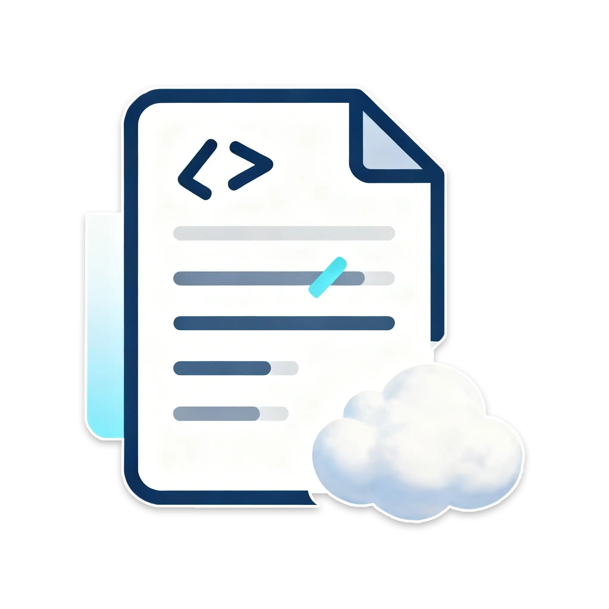

<div align="center">



# 清蒸云鸭の文档

面向 QQ 机器人、Minecraft 服务器及云服务场景的中文技术文档。

[](https://docs.meowyun.cn/)
[](https://vitepress.dev/zh/)
[](LICENSE)

[在线文档](https://docs.meowyun.cn/) · [备用站点](https://docs.thecatyun.top/) · [问题反馈](https://github.com/WhiteCloudOL/meowyun_docs/issues)

</div>

## 项目简介

本仓库包含[清蒸云鸭の文档](https://docs.meowyun.cn/)的全部源文件与站点配置。项目基于 [VitePress](https://vitepress.dev/zh/) 构建，旨在提供结构清晰、步骤完整且便于复现的中文部署与运维指南。

### 文档范围

- **QQ 机器人**：AstrBot、MaiBot、NapCat、LLBot 等项目的部署、配置与使用。
- **Minecraft 服务器**：服务器远程管理、常用命令及相关实践。
- **雨云服务**：账号注册、产品选购，以及通过游戏云面板部署 Minecraft 服务端。

> [!IMPORTANT]
> 第三方软件的界面和配置可能随版本更新而变化。使用教程前，请留意文中注明的适用版本与环境；如发现内容过时，请通过 [Issue](https://github.com/WhiteCloudOL/meowyun_docs/issues) 反馈。

## 在线访问

| 站点 | 地址 | 说明 |
| --- | --- | --- |
| 主站 | [docs.meowyun.cn](https://docs.meowyun.cn/) | 国内访问入口 |
| 备用站 | [docs.thecatyun.top](https://docs.thecatyun.top/) | Cloudflare Pages 镜像 |

## 本地开发

### 环境要求

- [Node.js](https://nodejs.org/) LTS
- npm

### 安装与启动

```bash
git clone https://github.com/WhiteCloudOL/meowyun_docs.git
cd meowyun_docs
npm ci
npm run docs:dev
```

开发服务器启动后，请根据终端输出访问本地预览地址。修改 `docs/` 目录内的 Markdown 文件时，页面将自动更新。

### 可用脚本

| 命令 | 用途 |
| --- | --- |
| `npm run docs:dev` | 启动开发服务器 |
| `npm run docs:build` | 构建生产版本 |
| `npm run docs:check-seo` | 检查构建后的标题、摘要、规范网址、站点地图和旧地址跳转 |
| `npm run docs:preview` | 本地预览生产构建 |

生产构建默认输出至 `docs/.vitepress/dist/`。

### 静态服务器与 EdgeOne

本站启用了 `cleanUrls`。构建会同时生成 `mcs/remote.html` 和 `mcs/remote/index.html`，让支持目录索引的静态服务器也能在直接访问、刷新或分享无后缀链接时返回完整正文。请部署完整构建目录，包括新增的目录入口。

Nginx / OpenResty 可在站点配置中使用以下规则，让无后缀地址直接返回对应的 HTML：

```nginx
location / {
    try_files $uri $uri.html $uri/ =404;
}
```

不要把所有文档路径回退到首页或空的 `404.html`：VitePress 首次加载依赖当前页面预渲染的正文，返回其他页面的 HTML 会导致正文空白。如果 EdgeOne 已缓存旧的 404 响应，部署后需刷新对应路径的缓存。HTML 页面和 `hashmap.json` 应及时更新，带内容哈希的 `/assets/` 文件可长期缓存。

## 搜索引擎与分享信息

主站规范域名为 `https://docs.meowyun.cn`，由 `docs/.vitepress/seo.ts` 统一设置。镜像站沿用主站的 canonical 地址；同一页面的 `.html` 和目录入口也指向相同的无后缀网址。

每篇文档在开头填写独立的标题和摘要，标题应说明软件名称与教程主题。它们用于浏览器标题、搜索摘要以及分享信息，不会修改正文标题：

```yaml
---
title: MaiBot AI 模型配置教程
description: 为 MaiBot 添加模型服务商与可用模型，分配回复、规划和识图任务并测试连接。
---
```

`description` 简要说明本页能解决的问题，不必堆叠关键词。页面会自动生成 canonical、Open Graph、Twitter 分享信息和 WebSite / WebPage 结构化数据，分享图片使用站点 Logo。

内容仍在编写或不希望被收录的页面，可在同一处添加 `noindex: true`。构建时会输出 `noindex, follow` 并从站点地图排除。联系方式页保留不收录设置；Fabric、Forge 专页完善后可移除该设置，同时更新 `scripts/check-seo.mjs` 中的排除列表。

构建会输出 `sitemap.xml` 和正确命名的 `robots.txt`。发布后，可在 Google Search Console、Bing Webmaster Tools 或百度搜索资源平台验证站点，并提交主站的 `https://docs.meowyun.cn/sitemap.xml`。实际抓取、收录和搜索结果摘要由搜索引擎决定。

旧版 MaiBot 的 `conf`、`plugins`、`plugins_index`、`use` 地址已在 `seo.ts` 中登记迁移目标。构建同时输出 Cloudflare Pages 的 `_redirects`（301）与普通静态服务器可用的即时跳转页面。使用 Nginx / EdgeOne 时，也可按该映射在服务器或控制台设置 301；跳转页面不加入站点地图。

发布前运行以下检查，GitHub Actions 部署流程也会自动执行：

```bash
npm run docs:build
npm run docs:check-seo
```

## 目录结构

```text
.
├─ docs/
│  ├─ .vitepress/       # 站点配置与主题扩展
│  ├─ info/             # 项目说明与联系方式
│  ├─ mcs/              # Minecraft 服务器文档
│  ├─ qqbot/            # QQ 机器人文档
│  ├─ rainyun/          # 雨云服务文档
│  ├─ resources/        # 图片等静态资源
│  └─ index.md          # 站点首页
├─ package.json         # 项目依赖与脚本
└─ README.md
```

## 贡献指南

欢迎提交内容修正、新增教程或站点改进。建议遵循以下流程：

1. Fork 本仓库并基于最新代码创建分支。
2. 在 `docs/` 目录中修改或新增文档。
3. 执行 `npm run docs:dev` 检查内容、链接与页面排版。
4. 执行 `npm run docs:build`，确保生产构建成功。
5. 提交 Pull Request，并说明修改目的、适用范围及验证方式。

新增教程时，请明确软件版本、运行环境和前置条件。文档图片应存放于 `docs/resources/images/` 下对应的分类目录，并使用具有辨识度的文件名。

### 胶囊标签

主题中的自定义组件已全局注册，可直接插入 `docs/` 下的 Markdown，无需单独导入。组件源码位于 `docs/.vitepress/theme/`，注册入口为 `index.js`。

#### Tag 胶囊标签

默认显示“推荐”，支持自定义文字与颜色。字号随所在正文或标题自动缩放，范围为 `14–20px`（按默认根字号计算）；宽度由文字长度决定，内边距随字号缩放。

```md
## 自动部署 <Tag />

## 其他方案 <Tag>可选</Tag>

| 方案 | 标记 |
| --- | --- |
| 自动部署 | <Tag /> |

适用于首次部署 <Tag text="新手适用" />

## 自动部署 <Tag text="推荐" color="#15803d" />

<Tag color="#2563eb">进阶</Tag>

<Tag text="推荐" text-color="#15803d" border-color="#86efac" />

<Tag text="进阶" color="#2563eb" text-color="#1e40af" border-color="#93c5fd" />
```

| 参数 | 默认值 | 说明 |
| --- | --- | --- |
| `text` | `推荐` | 标签文字，也可通过 `<Tag>文字</Tag>` 设置；插槽内容优先 |
| `color` | 主题默认色 | 整体配色：字体与边框直接使用指定颜色，背景使用该颜色的淡色效果 |
| `text-color` | 跟随 `color` 或主题默认色 | 单独设置字体颜色，优先于 `color`，不影响背景与边框 |
| `border-color` | 跟随 `color` 或主题默认色 | 单独设置边框颜色，优先于 `color`，不影响字体与背景 |

颜色参数支持十六进制、`rgb()`、`hsl()`、CSS 颜色名称或变量。只设置 `color` 时整体调整；同时设置 `text-color` 或 `border-color` 时，对应部分使用单独指定的颜色。

默认配色适配浅色与深色主题。显式指定 `color` 后，两种主题均使用该颜色，请选择在两种背景下均清晰的颜色。标签可用于标题、正文和表格，不会将标签文字加入右侧目录。

#### Badge 状态标签

VitePress 内置的 `Badge` 可直接用于 Markdown，`text` 设置文字，`type` 选择配色类型，默认是 `tip`。

```md
<Badge type="tip" text="推荐" />
<Badge type="info" text="内置" />
<Badge type="warning" text="需要配置" />
<Badge type="danger" text="版本不兼容" />
<Badge type="tip">自定义文字</Badge>
```

支持 `tip`、`info`、`warning`、`danger` 四种类型；插槽文字优先于 `text`。配色跟随站点主题，需要自定义字体、边框颜色或自适应字号时使用 `Tag`。

#### PluginCard 插件卡片

用于按分类展示插件。卡片默认显示名称、标签、简介和仓库入口，详细步骤放在可展开的“配置与使用”中。使用 `plugin-grid` 容器时，桌面端两列，窄屏单列。

```md
<div class="plugin-grid">

<PluginCard name="插件名称" repo="作者/仓库" author="作者名称" label="语音回复" description="简要说明插件用途">

1. 打开插件设置，填写所需信息。
2. 保存后在测试会话中验证。

</PluginCard>

</div>
```

`name` 与 `description` 必填；`repo` 填写 GitHub 的 `作者/仓库`，或通过 `href` 指定文档等链接（优先于 `repo`）。`author` 设置作者署名，留空时显示仓库所属账号。`label` 设置胶囊文字，`notice` 显示兼容要求等提示。组件与内部 Markdown 之间保留空行。

#### 其他全局组件

| 组件 | 用途 | 使用方式 |
| --- | --- | --- |
| `HomePage` | 文档首页内容 | `<HomePage />`，布局由首页维护 |
| `SiteCounter` | 站点访问计数 | `<SiteCounter />`，用于欢迎页等访问统计位置 |

## 许可证

本项目依据 [GNU Affero General Public License v3.0](LICENSE) 开源。使用、修改或分发本项目内容前，请确保遵守许可证条款。
