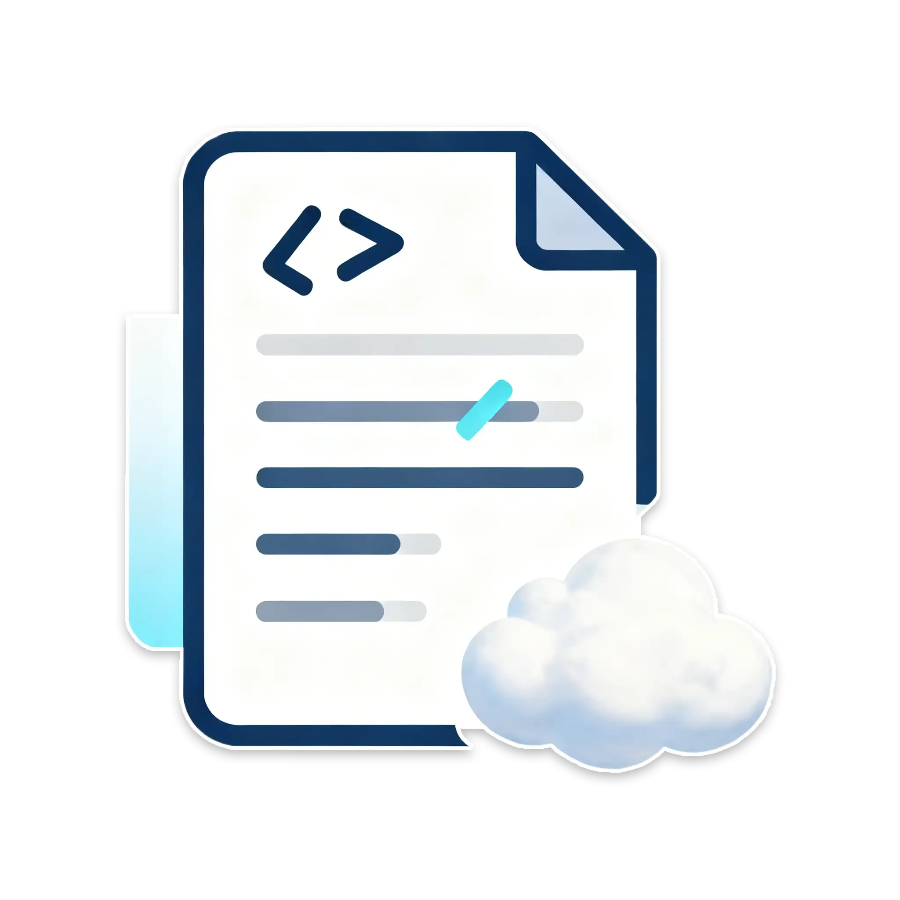

<div align="center">



# 清蒸云鸭の文档

面向 QQ 机器人、Minecraft 服务器及云服务场景的中文技术文档。

[](https://docs.meowyun.cn/)
[](https://vitepress.dev/zh/)
[](LICENSE)

[在线文档](https://docs.meowyun.cn/) · [备用站点](https://docs.catyun.cyou/) · [问题反馈](https://github.com/WhiteCloudOL/meowyun_docs/issues)

</div>

## 项目简介

本仓库包含[清蒸云鸭の文档](https://docs.meowyun.cn/)的全部源文件与站点配置。项目基于 [VitePress](https://vitepress.dev/zh/) 构建，旨在提供结构清晰、步骤完整且便于复现的中文部署与运维指南。

### 文档范围

- **QQ 机器人**：AstrBot、MaiBot、NapCat、LLBot 等项目的部署、配置与使用。
- **Minecraft 服务器**：服务器远程管理、常用命令及相关实践。
- **雨云服务**：账号注册、产品选购，以及通过游戏云面板部署 Minecraft 服务端。

> [!IMPORTANT]
> 第三方软件的界面和配置可能随版本更新而变化。使用教程前，请留意文中注明的适用版本与环境；如发现内容过时，请通过 [Issue](https://github.com/WhiteCloudOL/meowyun_docs/issues) 反馈。

## 在线访问

| 站点 | 地址 | 说明 |
| --- | --- | --- |
| 主站 | [docs.meowyun.cn](https://docs.meowyun.cn/) | 国内访问入口 |
| 备用站 | [docs.catyun.cyou](https://docs.catyun.cyou/) | Cloudflare Pages 镜像 |

## 本地开发

### 环境要求

- [Node.js](https://nodejs.org/) LTS
- npm

### 安装与启动

```bash
git clone https://github.com/WhiteCloudOL/meowyun_docs.git
cd meowyun_docs
npm ci
npm run docs:dev
```

开发服务器启动后，请根据终端输出访问本地预览地址。修改 `docs/` 目录内的 Markdown 文件时，页面将自动更新。

### 可用脚本

| 命令 | 用途 |
| --- | --- |
| `npm run docs:dev` | 启动开发服务器 |
| `npm run docs:build` | 构建生产版本 |
| `npm run docs:preview` | 本地预览生产构建 |

生产构建默认输出至 `docs/.vitepress/dist/`。

## 目录结构

```text
.
├─ docs/
│  ├─ .vitepress/       # 站点配置与主题扩展
│  ├─ info/             # 项目说明与联系方式
│  ├─ mcs/              # Minecraft 服务器文档
│  ├─ qqbot/            # QQ 机器人文档
│  ├─ rainyun/          # 雨云服务文档
│  ├─ resources/        # 图片等静态资源
│  └─ index.md          # 站点首页
├─ package.json         # 项目依赖与脚本
└─ README.md
```

## 贡献指南

欢迎提交内容修正、新增教程或站点改进。建议遵循以下流程：

1. Fork 本仓库并基于最新代码创建分支。
2. 在 `docs/` 目录中修改或新增文档。
3. 执行 `npm run docs:dev` 检查内容、链接与页面排版。
4. 执行 `npm run docs:build`，确保生产构建成功。
5. 提交 Pull Request，并说明修改目的、适用范围及验证方式。

新增教程时，请明确软件版本、运行环境和前置条件。文档图片应存放于 `docs/resources/images/` 下对应的分类目录，并使用具有辨识度的文件名。

## 许可证

本项目依据 [GNU Affero General Public License v3.0](LICENSE) 开源。使用、修改或分发本项目内容前，请确保遵守许可证条款。
