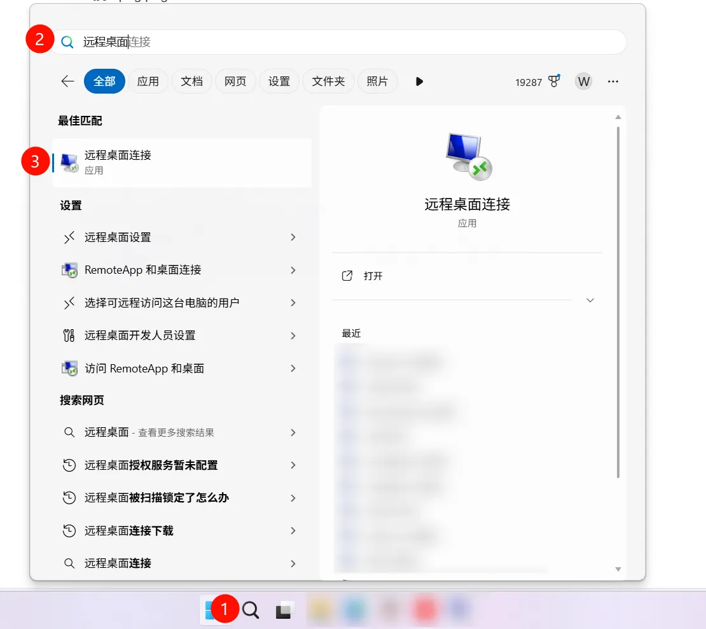
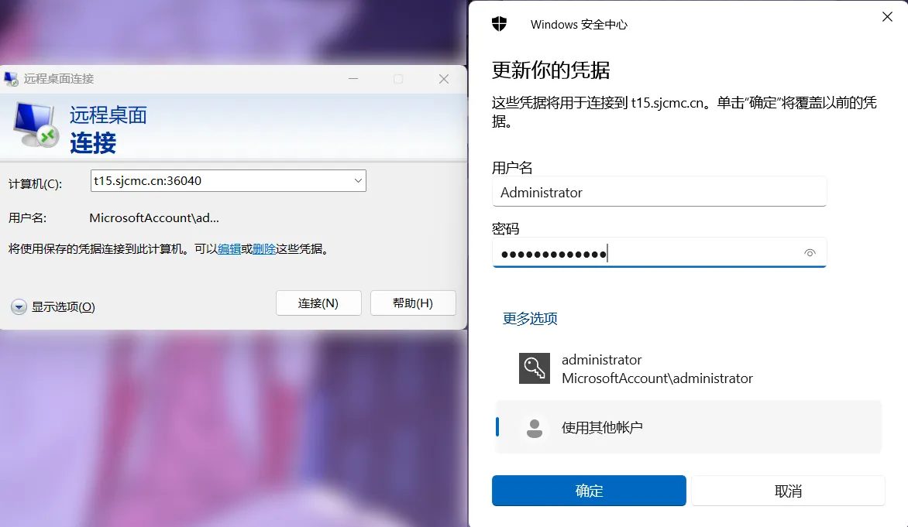

# 远程管理服务器

本文分别介绍 Windows 与 Linux 服务器的远程连接方式。文档作者：清蒸云鸭。

::: warning 安全要求
首次登录后建议立即修改默认密码，并仅在防火墙或安全组中放行必要的远程管理端口。不要在公开聊天中发送服务器地址、用户名、密码或私钥。
:::

## Windows 管理

### 可用客户端

| 使用设备 | 推荐客户端 |
| --- | --- |
| Windows 电脑 | 远程桌面连接（Remote Desktop） |
| 手机 | Microsoft Remote Desktop / Windows App |

手机端客户端的具体操作不在本文展开，可根据对应应用的官方说明完成配置。

### 1. 远程连接服务器

1. 按下 `Win + S` 打开系统搜索，输入“远程桌面连接”并启动该应用。

   

2. 复制服务器的**远程连接地址**。该地址通常由 `IP:端口` 组成；使用独立 IP 且保持默认端口时，一般只需填写 IP 地址。

3. 点击“连接”。出现凭据窗口后，依次选择“更多选项”和“使用其他账户”。

   

4. 输入服务器的**用户名**和**密码**。Windows 云服务器的默认用户名通常为 `Administrator`，请以服务商控制台显示的信息为准。

5. 核对服务器证书或连接目标后点击确认，即可进入服务器远程桌面。

### 2. 启动、停止或重启服务端

此部分原计划补充（Waiting for adding），目前仍在编写中。完成远程连接后，可先按照所使用服务端的启动脚本或面板说明进行管理。

## Linux 管理

### 可用客户端

| 使用设备 | 推荐客户端 |
| --- | --- |
| 电脑 | Tabby Terminal、FinalShell、Xshell + Xftp |
| 手机 | Termius |

Linux 远程管理部分原计划补充（Waiting for adding），目前仍在编写中。通常需要从服务商控制台获取 SSH 地址、端口、用户名和密码或私钥，再通过上述客户端建立连接。

::: tip 下一步
登录 Linux 服务器后，建议先确认当前用户、系统版本、磁盘空间和可用内存，再开始安装运行环境或服务端程序。
:::

