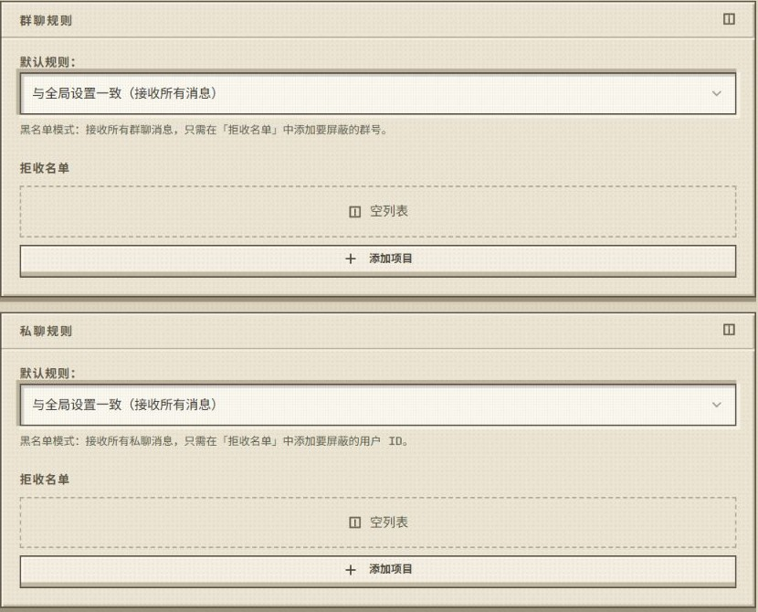

# 群聊与私聊规则

接收规则用于指定机器人可以参与的群聊和私聊。OneBot 与 QQ 官方机器人共用 MaiBot 的规则管理页面，群聊和私聊分别配置。

## 打开规则页面

1. 点击左侧 `适配器设置`。
2. 打开已连接的适配器。
3. 在 `黑白名单规则` 中确认 `当前账号 ID`。该账号应与本次配置的机器人一致。

适配器连接后才会显示账号规则。页面提示尚未连接时，先完成 [OneBot 连接](/qqbot/maibot/adapters/onebot) 或 [QQ 官方机器人连接](/qqbot/maibot/adapters/qq-official)。

## 仅接收指定群和用户

以下以 OneBot 测试账号为例。QQ 官方机器人应使用 OpenID，具体对应关系见下方的标识说明。

1. 找到 `群聊规则`，将默认规则设为 `默认不接收消息`。
2. 在 `接收名单` 中点击 `添加项目`，填入一个测试群的群号。
3. 在 `私聊规则` 中同样选择 `默认不接收消息`，添加操作者的 QQ 号。
4. 等待页面显示已保存，再开始测试。

<figure class="conf-shot conf-shot--compact">
  
  <figcaption>群聊和私聊分别设置；图中选择的是跟随全局接收，按上面的步骤可改为只接收名单中的聊天</figcaption>
</figure>

完成上述设置后，机器人仅接收指定测试群和测试用户的消息。需要接收全部群聊时，将群聊默认规则改为 `接收所有消息`；需要排除个别群，则把它们加入 `拒收名单`。

`与全局设置一致` 表示使用适配器列表顶部的群聊、私聊开关。群聊和私聊可以分别选择。已有多套规则时，还可以在 `默认分组` 下拉框中切换。

这些名单由 MaiBot 统一保存到当前机器人的 `config/adapter_policy.toml`，OneBot 和 QQ 官方机器人都在这里管理聊天范围。

## 名单中的 ID

| 接入方式 | 群聊名单 | 私聊名单 |
| --- | --- | --- |
| OneBot | 数字群号 | 用户 QQ 号 |
| QQ 官方机器人，未绑定 | `group_openid` | `user_openid` |
| QQ 官方机器人，已绑定 | 消息记录中实际使用的绑定群号 | 消息记录中实际使用的绑定 QQ 号 |

官方机器人的 OpenID 可从收到的消息记录或日志中查看。绑定步骤见 [QQ 身份绑定与同步](/qqbot/maibot/adapters/qq-identity)。

## 规则分组

同一账号可以保存多套规则，例如日常使用和临时测试。

1. 打开当前分组旁的操作菜单。
2. 新建分组，或复制当前分组。
3. 在新分组中填写群聊和私聊名单。
4. 从分组下拉列表选中需要使用的分组。

新建或复制后，需要切换到该分组才会使用其中的规则。

## 保存与验证

停止编辑后等待页面显示已保存，再从允许的群或用户发送测试消息。切换机器人账号后，应重新确认规则归属。

同一个 ID 只能位于接收名单或拒收名单中的一处。名单条目关闭后暂不参与匹配，重新打开即可恢复。
