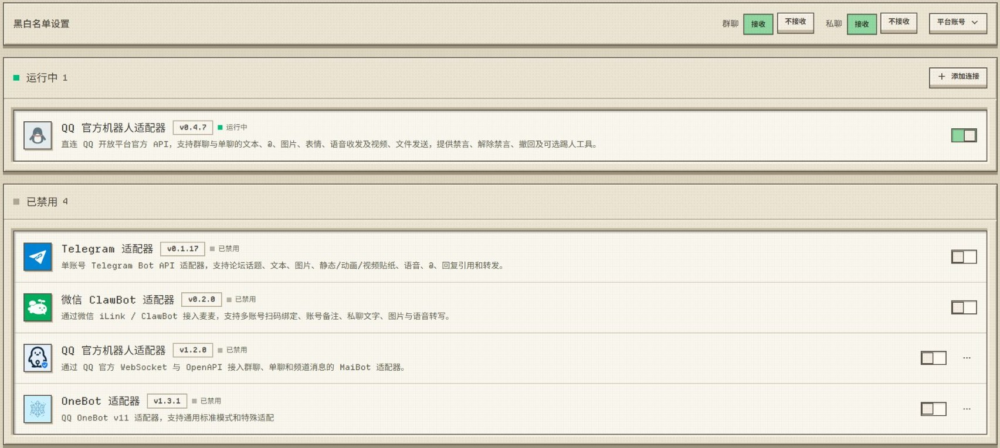

# 平台接入概览

适配器负责连接聊天平台，将平台消息交给 MaiBot，并将生成的回复发送回原会话。完成模型和人格设置后，可根据账号类型选择接入方式。

## QQ 接入方式

| 项目 | OneBot 接入 | QQ 官方机器人 |
| --- | --- | --- |
| 使用的账号 | 普通 QQ 账号 | QQ 开放平台创建的机器人 |
| 连接凭据 | 协议端 WebSocket 地址、端口与 Token | 扫码授权，或 AppID 与 AppSecret |
| 额外程序 | NapCat、LLBot 或 SnowLuma | 由内置适配器直接连接平台 |
| 配置入口 | 适配器设置 → OneBot 适配器 | 适配器设置 → QQ 官方机器人适配器 |
| 群与用户标识 | 数字群号与 QQ 号 | OpenID，绑定后可使用真实群号与 QQ 号 |
| 详细步骤 | [OneBot 适配器配置](/qqbot/maibot/adapters/onebot) | [QQ 官方机器人配置](/qqbot/maibot/adapters/qq-official) |

已有普通 QQ 账号和协议端环境时，可选择 OneBot 接入。已在 QQ 开放平台创建机器人时，可使用官方适配器。

## 适配器管理入口

1. 在侧栏底部选中目标机器人。
2. 点击左侧 `适配器设置`。
3. 找到所需适配器，点击名称进入配置页。
4. 第三方适配器尚未安装时，点击 `添加连接` 查找并安装。
5. 填写连接信息，启用并保存，查看连接状态。

<figure class="conf-shot">
  
  <figcaption>适配器管理入口与运行状态</figcaption>
</figure>

## 接收规则

连接成功后，在适配器配置页设置 `黑白名单规则`。可以仅接收指定群和用户，也可以接收全部消息并排除个别会话。

完整说明见 [群聊与私聊规则](/qqbot/maibot/adapters/adapter-policy)。官方机器人的群号与用户 ID 使用 OpenID，绑定方法见 [QQ 身份绑定与同步](/qqbot/maibot/adapters/qq-identity)。

## 验证顺序

1. 确认平台账号已登录或授权成功。
2. 确认 MaiBot 中的适配器显示已连接。
3. 在规则允许的群聊或私聊发送文字消息。
4. 查看日志中的接收记录，并确认平台显示最终回复。

遇到连接或发送问题时，参阅 [故障排查](/qqbot/maibot/usage/troubleshooting)。
