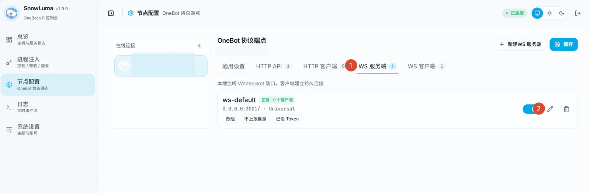
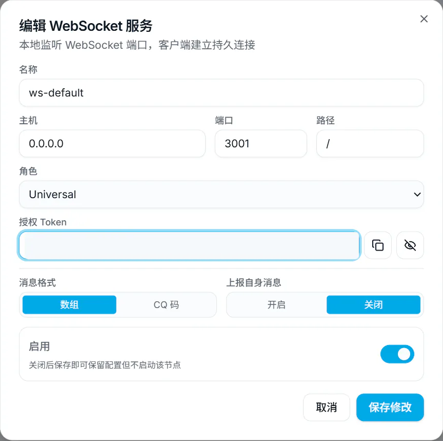
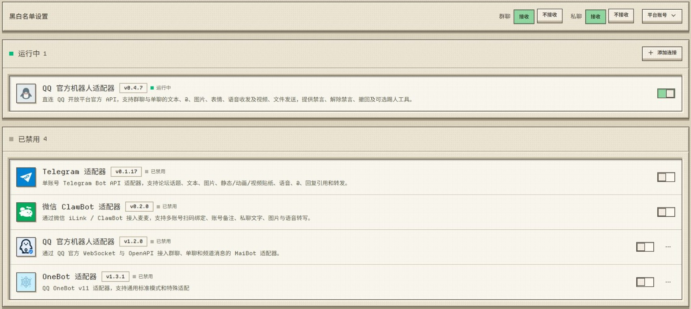
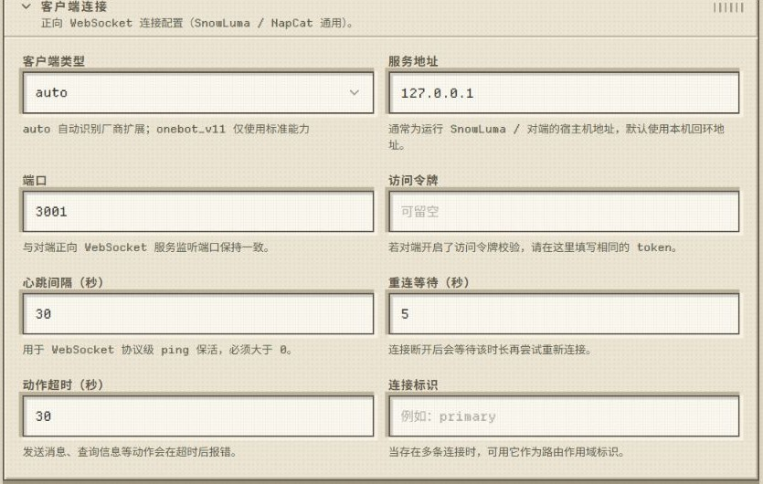

# OneBot 适配器配置

通过 OneBot 适配器连接 NapCat、LLBot 或 SnowLuma，使 MaiBot 使用普通 QQ 账号收发消息。

协议端是负责登录 QQ 的程序，例如 NapCat。MaiBot 中的适配器负责连接这个程序，完成消息接收和回复发送。

新版界面将统一的 SnowLuma Adapter 显示为 **OneBot 适配器**，插件 ID 仍是 `maibot-team.snowluma-adapter`。NapCat、LLBot、SnowLuma 均通过此入口连接。

## 配置协议端 WebSocket

首先安装所选协议端并完成 QQ 登录：

- [NapCat 部署](/qqbot/protos/napcat)
- [LLBot 部署](/qqbot/protos/llbot)
- [SnowLuma 部署](/qqbot/protos/snowluma)

打开协议端管理页面，找到 `网络配置` 或 `节点配置`，新建并启用 **正向 WebSocket / WebSocket 服务端**。按下表填写：

| 项目 | 填写内容 |
| --- | --- |
| 主机 / 监听地址 | MaiBot 与协议端在同一台电脑上原生运行时填 `127.0.0.1`；跨设备或容器连接时填 `0.0.0.0` |
| 端口 | `3001` |
| Token / 访问令牌 | 设置较长的随机字符串，在 MaiBot 中填写相同的值 |
| 路径 | 支持设置时保持 `/` |
| 消息格式 | 支持设置时选择 `数组` |

保存并启用连接。跨设备使用时，在协议端所在设备上放行该端口，并将来源限制为 MaiBot 所在设备。

::: details SnowLuma 的设置位置
进入 `节点配置`，选择已登录的 QQ 节点，打开 `WS 服务端`。角色选择 `Universal`，上报自身消息保持关闭。

<figure class="conf-shot">
  
  <figcaption>在已登录的节点中启用 WS 服务端</figcaption>
</figure>

<figure class="conf-shot conf-shot--compact">
  
  <figcaption>记录地址、端口和 Token，下一步填入 MaiBot</figcaption>
</figure>
:::

## 配置 MaiBot 连接

1. 回到 MaiBot 管理页面，点击左侧 `适配器设置`。
2. 找到并打开 `OneBot 适配器`。列表中还没有时，点击 `添加连接`，找到对应适配器并安装。
3. 在 `设置` 一侧向下找到 `客户端连接`。
4. 按下表填写，打开页面右上角的 `启用`，再点击 `保存`。

<figure class="conf-shot">
  
  <figcaption>点击适配器名称进入设置；右上角添加连接用于安装其他适配器</figcaption>
</figure>

| 配置项 | 填写说明 |
| --- | --- |
| 客户端类型 | 保持 `auto`，自动识别协议端 |
| 服务地址 | 同机原生运行填 `127.0.0.1`；跨设备填协议端所在设备的 IP；同一个 Docker Compose 网络中填协议端服务名 |
| 端口 | 填协议端设置的端口，例如 `3001` |
| 访问令牌 | 粘贴协议端设置的 WebSocket Token |
| 心跳、重连等待、动作超时 | 第一次配置保持默认 |
| 连接标识 | 只有一条连接时留空 |

<figure class="conf-shot conf-shot--compact">
  
  <figcaption>服务地址填写协议端所在位置，端口和访问令牌与协议端一致</figcaption>
</figure>

访问令牌使用协议端设置的 **WebSocket Token**。协议端管理页面的登录密码、MaiBot 管理页面的登录密码各自单独使用。

如果 MaiBot 和协议端在两个容器里，服务地址填写协议端的服务名；`127.0.0.1` 在容器里表示容器自己。

## 配置接收范围

连接成功后，继续设置 [群聊与私聊规则](/qqbot/maibot/adapters/adapter-policy)。OneBot 群聊名单填写数字群号，私聊名单填写用户 QQ 号。

## 验证连接

1. 确认协议端显示 QQ 已登录，MaiBot 中的适配器已连接。
2. 在接收名单内的群中 @机器人，发送一条文字消息。
3. 确认 MaiBot 日志记录入站消息，且 QQ 中显示回复。
4. 已配置识图模型时，发送一张图片并检查识别结果。

连接失败或未收到回复时，参阅 [故障排查](/qqbot/maibot/usage/troubleshooting)。
