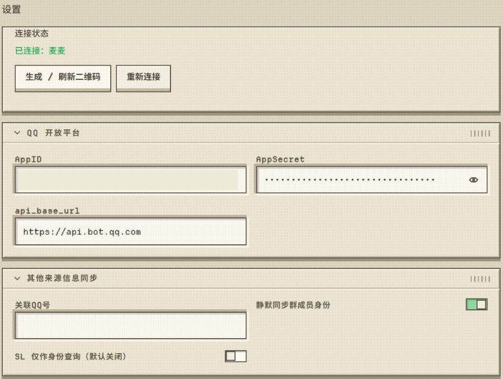
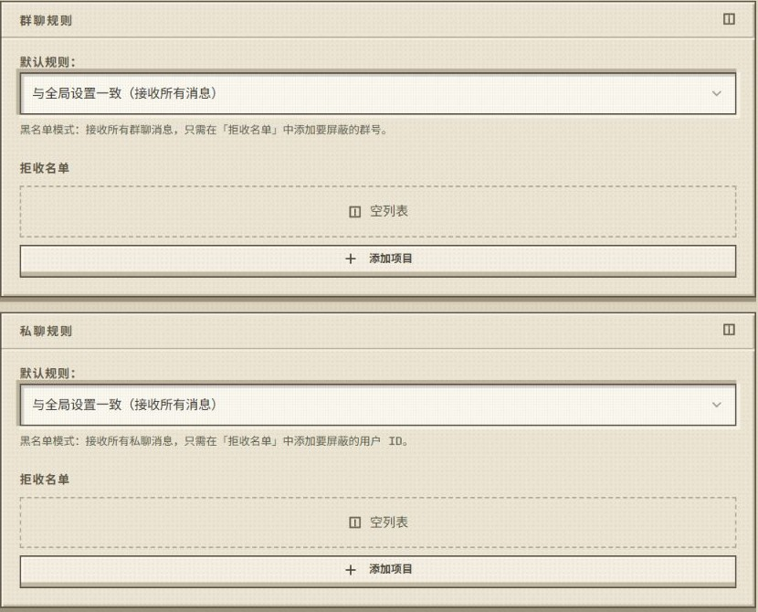

# QQ 官方机器人配置

QQ 官方机器人适配器用于连接 QQ 开放平台。首先在 QQ 开放平台创建机器人，再通过适配器连接 MaiBot。完成后，可以通过 QQ 单聊或群聊与麦麦交流。

本文介绍 MaiBot 内置的 **QQ 官方机器人适配器**，插件 ID 为 `Mai-with-u.qq-adapter`，按 MaiBot 1.4.5 中的界面整理。

## 准备事项

- 已经启动 MaiBot，并能登录管理页面。
- 已经完成 [AI 模型配置](/qqbot/maibot/config/models)，麦麦有可用的回复和规划模型。
- 一个可用于创建机器人的 QQ 账号。

如需使用普通 QQ 账号登录 NapCat、LLBot 或 SnowLuma，请阅读 [OneBot 接入步骤](/qqbot/maibot/adapters/onebot)。官方机器人使用开放平台账号，可以直接在 MaiBot 中连接。

## 第一步：创建 QQ 机器人

1. 打开 [QQ 开放平台](https://q.qq.com/)，登录 QQ 账号。
2. 按页面提示完成开发者入驻并创建机器人。也可以从 [QQ 机器人快速创建入口](https://q.qq.com/qqbot/openclaw/)开始。
3. 设置机器人名称和头像，进入机器人管理页面。
4. 查看机器人已开放的使用场景，例如单聊、群聊，以及可添加的测试用户和测试群。
5. 按平台页面提示将机器人添加到测试会话中。

快速创建的私人机器人可能只允许创建者单聊。需要群聊时，先在开放平台确认当前机器人支持群聊，再添加到群中。

## 第二步：打开 MaiBot 中的适配器

1. 回到 MaiBot 管理页面，选中要连接的目标机器人。
2. 点击左侧的 `适配器设置`，找到 `QQ 官方机器人适配器`。
3. 点击适配器名称，打开设置页。

该适配器随 MaiBot 内置提供，并随主程序更新，可在配置页启用或停用。

如果列表里有两个同名项目，打开 `查看详情`，选择插件 ID 为 **`Mai-with-u.qq-adapter`** 的内置项目。

## 第三步：连接机器人

支持扫码授权和手动填写凭据两种连接方式，可根据已有凭据选择其中一种。

### 方式一：使用 QQ 扫码

1. 打开适配器页面右上角的 `启用` 开关；页面有待保存修改时，点击 `保存`。
2. 在 `连接状态` 区域点击 `生成 / 刷新二维码`。
3. 用手机 QQ 扫码，在 QQ 官方页面中选择并授权要连接的机器人。
4. 回到 MaiBot 页面，等待状态变为 `已连接`。

扫码成功后，MaiBot 会保存这次授权取得的机器人信息，并连接机器人。二维码过期后，重新生成一个即可；需要中止时，点击取消扫码。

如果此前已配置机器人，扫码授权会替换原有的 AppID 和 AppSecret，扫码授权时应确认目标机器人名称。

### 方式二：手动填写 AppID 和 AppSecret

1. 在 QQ 开放平台的机器人管理页面中找到 **AppID** 和 **AppSecret**，有些页面将后者称为 **ClientSecret**。
2. 回到 MaiBot，展开 `QQ 开放平台`。
3. 将两项信息分别粘贴到 `AppID` 和 `AppSecret`。
4. `api_base_url` 保持默认的 `https://api.bot.qq.com`。
5. 打开右上角的 `启用`，点击 `保存`，等待连接完成。

<figure class="conf-shot conf-shot--compact">
  
  <figcaption>扫码连接入口与手动凭据配置，AppID 已遮盖</figcaption>
</figure>

AppSecret 是机器人连接凭据，保存在本机配置中。平台重置 AppSecret 后，在适配器配置页更新并保存，再点击 `重新连接`。

连接成功后，适配器会自动向 MaiBot 上报机器人账号。普通使用无需再手动填写 `bot_config.toml` 中的 `qq_account`；AppID 用于开放平台认证，也不用填到 QQ 账号位置。

## 第四步：配置接收规则

同一设置页的 `黑白名单规则` 用于控制麦麦接收哪些消息。连接成功后，该区域显示 `当前账号 ID`。

建议先仅允许一个测试群和操作者的单聊：

1. 在 `群聊规则` 的默认规则中选择 `默认不接收消息`。
2. 在 `接收名单` 点击 `添加项目`，填入测试群的 ID。
3. 在 `私聊规则` 中同样选择 `默认不接收消息`。
4. 添加操作者的用户 ID，等待页面显示已保存。

<figure class="conf-shot conf-shot--compact">
  
  <figcaption>连接成功后，分别配置群聊和私聊接收范围</figcaption>
</figure>

### 官方机器人标识

QQ 开放平台使用 **OpenID** 来区分群和用户。它是一串字母、数字组成的标识，可以在 MaiBot 收到的消息记录或日志中查看。

| 设置对象 | 未绑定时使用的标识 |
| --- | --- |
| 群聊接收 / 拒收名单 | 群的 `group_openid` |
| 单聊接收 / 拒收名单 | 用户的 `user_openid` |
| 群内成员身份 | 事件中的 `member_openid` |

初次连接还没有消息记录时，可以先保持全局默认接收，在已经添加机器人的测试群或单聊中发一句话，取得 ID 后再收紧名单。

完成 QQ 号绑定后，新消息会使用绑定后的群号或用户 QQ 号。此时回到名单页面，按消息中实际显示的 ID 更新规则。

### 群聊全量消息设置

由群主在 QQ 中打开群设置，找到当前机器人，将 `机器人可获取的群聊消息范围` 设置为 `获取群内全部消息`。每个使用机器人的群分别设置。

QQ 中的消息范围决定平台向机器人提供哪些消息，MaiBot 接收规则决定其中哪些会话可以参与。两项设置共同控制群聊接收范围。

## 第五步：测试聊天

1. 先在单聊中发送“你好”，等待回复。
2. 在已放行的群中 @机器人，发送一句简单的话。
3. 配置了识图模型后，再发送一张普通图片，检查图片识别结果。
4. 打开 MaiBot 左侧的 `日志`，查看同一时间是否有连接或发送错误。

确认消息接收和回复发送正常后，可继续调整 [昵称、人格和回复频率](/qqbot/maibot/config/personality)。

## 群管理工具

适配器设置下方有三个工具区。开启后，麦麦可以在对话中根据情况使用相应工具。

| 区域 | 默认状态 | 配置内容 |
| --- | --- | --- |
| 禁言工具 | 开启 | 生效群、保护用户、最短与最长禁言时长；也支持解除禁言 |
| 撤回工具 | 开启 | 允许使用撤回的群；单聊可撤回机器人自己的消息 |
| 踢人工具 | 关闭 | 需要时开启，并设置生效群和保护用户 |

`allowed_groups` 表示允许使用这个工具的群，留空表示不限制群；`admin_users` 是保护用户名单。仅使用聊天功能时，可关闭管理工具，按需启用。

群管理操作还需要 QQ 侧的相应权限。例如禁言需要机器人具备群管理员权限；移出成员接口目前还需要平台开通对应能力。撤回通常限消息发送后的两分钟内。


## 后续设置

- [QQ 身份绑定与同步](/qqbot/maibot/adapters/qq-identity)：绑定群号、用户 QQ 号，并配置与 OneBot 的身份协作
- [群聊与私聊规则](/qqbot/maibot/adapters/adapter-policy)：配置账号接收范围和规则分组
- [故障排查](/qqbot/maibot/usage/troubleshooting#qq-官方机器人问题)：检查鉴权、群聊接收和回复发送

## 配置文件与参考资料

内置适配器的配置位于当前 **Bot 目录**下：

```text
config/builtin_plugins/qq_official_adapter/config.toml
```

基本连接字段如下，日常配置通过 WebUI 完成：

```toml
[plugin]
enabled = true
# config_version 使用程序自动生成的值

[qq_official]
app_id = "你的 AppID"
app_secret = "你的 AppSecret"
api_base_url = "https://api.bot.qq.com"
```

群聊与私聊名单保存在同一 Bot 目录的 `config/adapter_policy.toml`。备份时一并保留 `config/` 和 `data/`，也能保存 ID 绑定结果。

- [MaiBot 官方机器人接入文档](https://docs.maibot.chat/manual/adapters/qq-official)
- [QQ 开放平台](https://q.qq.com/)
- [MaiBot 源码](https://github.com/Mai-with-u/MaiBot/tree/main/src/plugins/built_in/qq_official_adapter)
