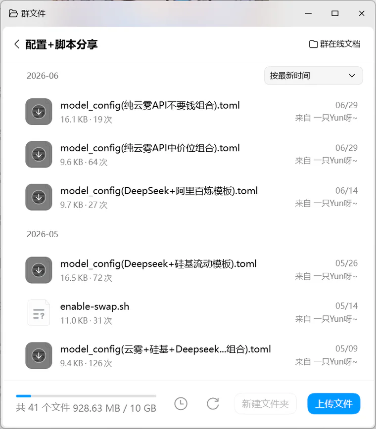
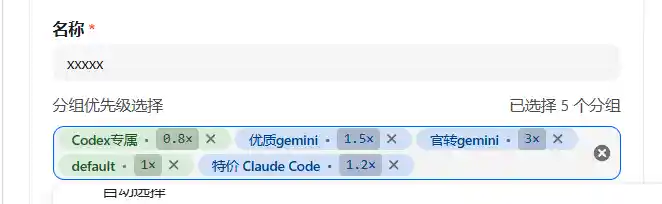
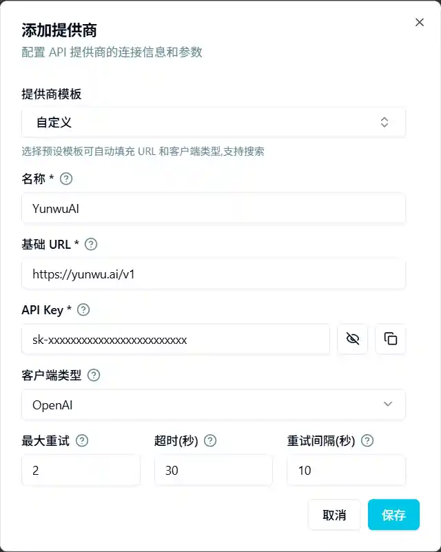
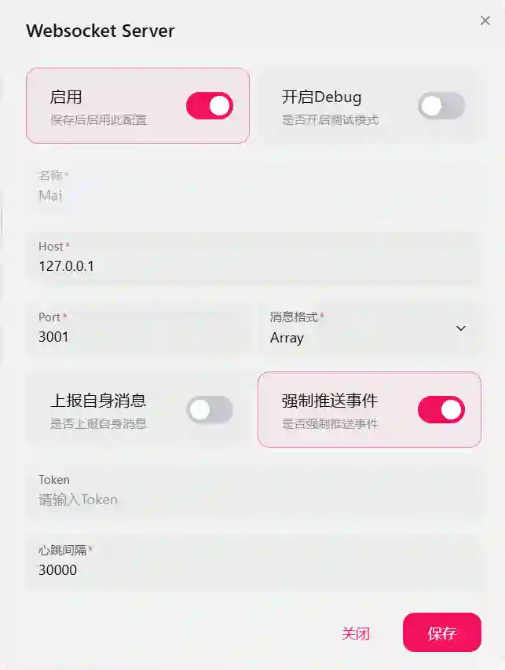
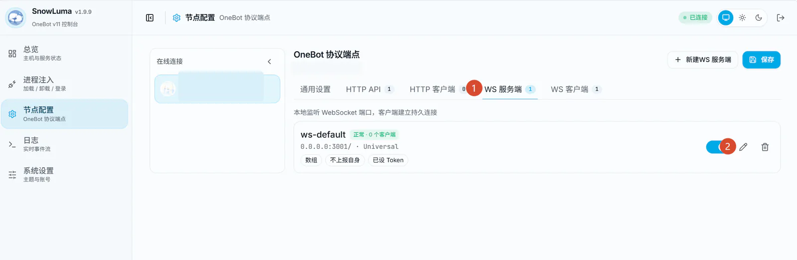
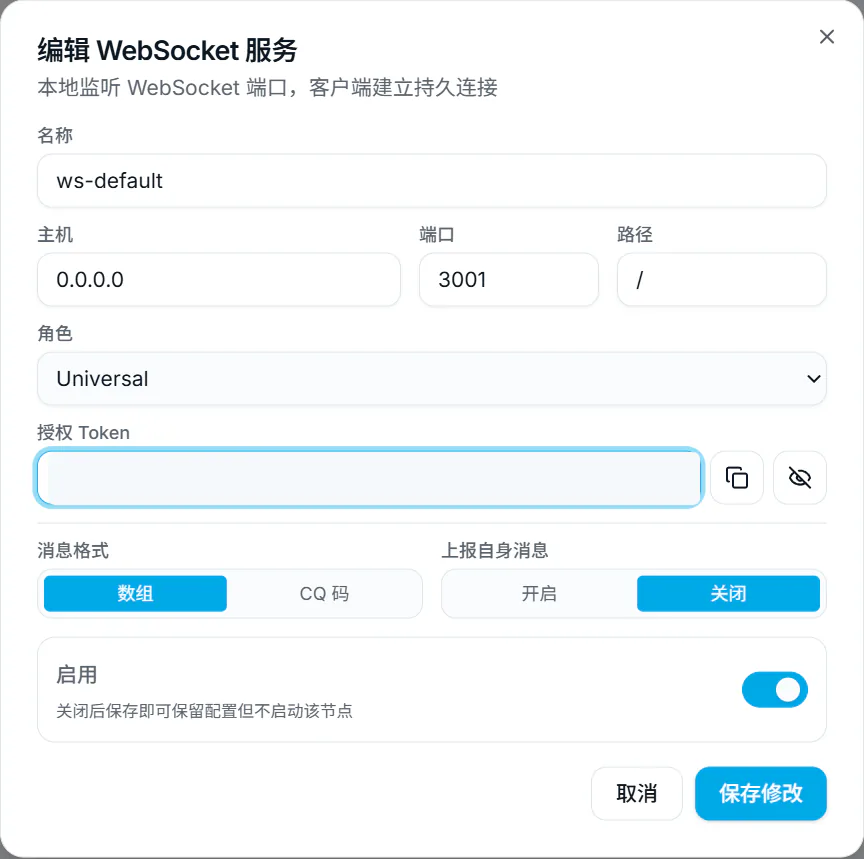
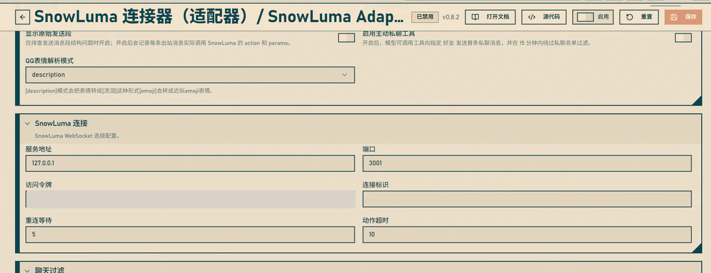
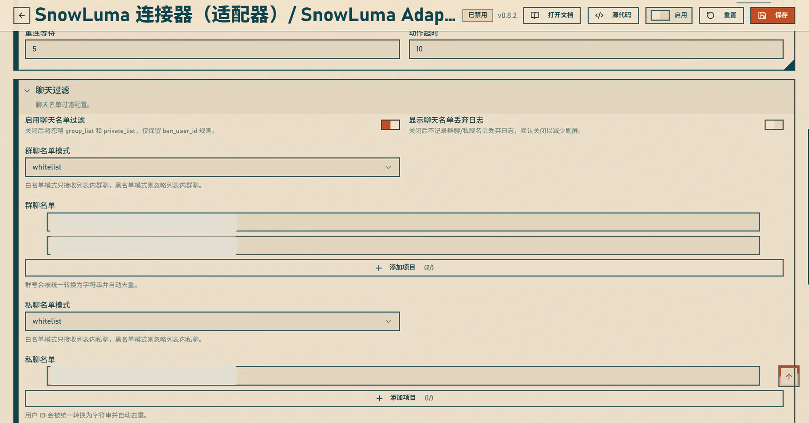

# MaiBot 配置与启动

<div class="conf-guide-hero">
  <div class="conf-guide-hero__copy">
    <span class="conf-guide-hero__eyebrow">MAIBOT SETUP MAP</span>
    <p>从第一次启动到 QQ 正常收发消息，按一条清晰的路线完成 WebUI、模型、人格与适配器配置。</p>
  </div>
  <div class="conf-guide-hero__ports" aria-label="常用端口">
    <span><b>8001</b> WebUI</span>
    <span><b>3001</b> QQ WebSocket</span>
  </div>
</div>

除首次开放 WebUI 或排查启动故障外，日常配置统一在 WebUI 中完成。本页仍保留关键文件路径，方便备份、迁移与故障定位。

::: warning 版本适配说明
MaiBot 仍在持续更新，不同版本的菜单名称和配置项可能略有差异。本文以当前插件版适配器为主；如页面说明与实际界面不一致，请以当前版本生成的配置和 WebUI 提示为准。
:::

## 推荐配置顺序

<div class="conf-journey" role="list" aria-label="MaiBot 推荐配置顺序">
  <div class="conf-journey__step" role="listitem"><span>01</span><strong>启动核心</strong><small>生成配置与数据目录</small></div>
  <div class="conf-journey__step" role="listitem"><span>02</span><strong>进入 WebUI</strong><small>确认地址与访问密钥</small></div>
  <div class="conf-journey__step" role="listitem"><span>03</span><strong>连接模型</strong><small>测试并分配核心任务</small></div>
  <div class="conf-journey__step" role="listitem"><span>04</span><strong>塑造人格</strong><small>校准称呼、语气与行为</small></div>
  <div class="conf-journey__step" role="listitem"><span>05</span><strong>接入 QQ</strong><small>连接适配器并测试消息</small></div>
</div>

## 文件路径速查

除特别说明外，下表路径均相对于 `maimai/MaiBot`。模型、人格和插件设置仍优先在 WebUI 中修改，文件路径主要用于确认配置位置、备份和排错。

| 路径 | 作用 | 建议操作 |
| --- | --- | --- |
| `bot.py` | MaiBot 启动入口 | 用于启动，不要直接修改 |
| `config/bot_config.toml` | Bot 身份、人格、聊天、WebUI 与运行配置 | 日常使用 WebUI；仅在无法远程访问 WebUI 时手动调整网络设置 |
| `config/model_config.toml` | API 提供商、模型列表与模型任务分配 | 使用 WebUI 管理；迁移或升级前备份 |
| `data/webui.json` | WebUI 访问密钥与认证信息 | 可以读取或备份；重置密钥时需先停止 MaiBot |
| `plugins/` | 已安装的插件和适配器 | 通过 WebUI 插件管理维护 |
| `plugins/<插件目录>/config.toml` | 单个插件的连接参数与功能设置 | 使用 WebUI 插件配置；目录名称可能因安装方式不同而变化 |
| `.venv/` | uv 创建的 Python 虚拟环境 | 不要手动移动或编辑其中的文件 |
| `../start.sh` | 部分旧版部署脚本提供的启动入口 | 仅在当前部署方式确实生成该文件时使用 |

## 目录与通信架构

以下结构以默认安装目录 `maimai` 为例。不同部署工具可能会调整协议端目录名称，但 MaiBot 主目录中的 `config`、`data` 和 `plugins` 作用相同。

```text
maimai/
├── MaiBot/
│   ├── .venv/                         # uv 虚拟环境
│   ├── bot.py                         # MaiBot 启动入口
│   ├── config/
│   │   ├── bot_config.toml            # Bot 与 WebUI 配置
│   │   └── model_config.toml          # 模型配置
│   ├── data/                          # WebUI、数据库与运行数据
│   └── plugins/
│       ├── MaiBot-Napcat-Adapter/     # NapCat / LLBot 适配器
│       └── MaiBot-SnowLuma-Adapter/   # SnowLuma 适配器
├── NapCat/                            # 可选：QQ 协议端
├── maimbot_tts_adapter/               # 可选：语音适配器
└── start.sh                           # 部分脚本部署方式提供
```

当前推荐的插件版适配器直接运行在 MaiBot 进程中，消息链路如下：

```text
QQ
↕
NapCat / LLBot / SnowLuma（正向 WebSocket 服务端，常用端口 3001）
↕
对应 Adapter 插件（WebSocket 客户端，运行在 MaiBot 内部）
↕
MaiBot 核心
└── WebUI（默认端口 8001）
```

::: info 关于 8000 端口
`maim_message` 的默认端口通常是 `8000`，主要供旧版或独立适配器使用。当前 NapCat 和 SnowLuma 插件版适配器不依赖这条连接，不要把它与协议端常用的 `3001` 端口混淆。
:::

## 首次启动

在 `maimai/MaiBot` 目录中执行：

```bash
# 如果当前位于 maimai 目录，先进入 MaiBot
cd MaiBot

# 前台启动，便于查看完整日志
uv run python bot.py
```

首次启动时，请根据终端提示阅读并接受用户协议。不同版本要求输入的确认文本可能不同，请以终端显示的内容为准，不要直接关闭窗口。

启动后，MaiBot 会自动生成默认配置并继续初始化 WebUI，无需为了生成配置再启动第二次。看到 WebUI 监听地址且日志中没有持续出现异常，即可继续配置。

::: tip 找不到配置文件？
确认当前启动的是正确的 MaiBot 目录，并检查首次启动是否因依赖、用户协议或 TOML 语法错误提前退出。`config/bot_config.toml` 和 `config/model_config.toml` 只会在初始化成功后出现。
:::

## 配置与访问 WebUI

MaiBot WebUI 默认使用 `host = ["127.0.0.1"]` 和端口 `8001`，因此本机通常可通过 `http://127.0.0.1:8001` 访问。服务器部署时，需要将监听地址改为 `host = ["0.0.0.0"]`，并同步配置访问白名单与防火墙；缺少任意一项都可能导致远程设备无法打开页面。

### 使用管理器初始化（推荐）

如果通过 MaiBot Manager TUI 部署，请打开 `设置` 或 `配置与访问`（名称可能因版本不同），选择 `初始化 MaiBot 访问配置`。管理器会调整 WebUI 监听地址，并在访问汇总中显示地址和密钥。

完成后重启 MaiBot，使监听地址完整生效。

### 手动开放远程访问

仅在无法通过管理器初始化时，才需要编辑 `maimai/MaiBot/config/bot_config.toml`。新版 `host` 是**字符串列表**；即使只监听一个地址，也必须保留方括号和引号。默认的 `host = ["127.0.0.1"]` 只接受本机连接，下面的示例用于开放远程访问。

::: details WebUI 网络配置示例
```toml
[webui]
enabled = true                         # 是否启动 WebUI 管理界面
host = ["0.0.0.0"]                    # 远程访问；默认值为 ["127.0.0.1"]
port = 8001                            # WebUI 默认访问端口
mode = "production"                   # 普通使用保持 production
webui_style = 1                        # 0 为旧风格，1 为未来复古风格
anti_crawler_mode = "basic"           # basic 以记录为主
allowed_ips = "127.0.0.1"             # 允许访问的 IP，多个地址使用英文逗号分隔
trusted_proxies = ""                   # 可信反向代理 IP
trust_xff = false                      # 是否信任 X-Forwarded-For
secure_cookie = false                  # 仅在 HTTPS 下设为 true
enforce_public_outbound_url = true     # 阻止 WebUI 访问受限的内网 URL
enable_paragraph_content = false       # 不加载知识图谱段落全文，减少内存占用
```
:::

- `host = ["127.0.0.1"]` 是默认值，只允许本机访问；改为 `host = ["0.0.0.0"]` 后会监听全部 IPv4 网卡。需要同时监听 IPv6 时可写为 `host = ["0.0.0.0", "::"]`。监听地址只负责接收连接，不等于已经放行防火墙。
- `allowed_ips` 必须包含实际访问设备的 IP，否则即使端口开放也会被拒绝。例如管理电脑的地址是 `192.168.1.100`，可写为 `allowed_ips = "127.0.0.1,192.168.1.100"`。
- 仅在反向代理来源可信时启用 `trust_xff`，并填写 `trusted_proxies`。
- 通过 HTTPS 反向代理访问时，可以启用 `secure_cookie`；直接使用 HTTP 时不要启用。
- 建议保持 `enforce_public_outbound_url = true`，避免 WebUI 被利用来访问不应暴露的内网地址。

::: danger 不要直接暴露管理面板
WebUI 包含配置、日志、插件和密钥等敏感信息。公网部署应设置强访问密钥，并通过云平台安全组、系统防火墙或带鉴权的反向代理限制来源地址。
:::

### 选择访问地址

#### 独立公网 IP 服务器

在云平台安全组和系统防火墙中放行 `8001/TCP`，并尽量将来源限制为自己的公网 IP；同时将管理设备的公网 IP 加入 `allowed_ips`。访问地址：

```text
http://<服务器 IP>:8001
```

不要为了访问 WebUI 直接关闭整机防火墙。

#### NAT 云服务器（共享 IP）

在服务商的 NAT 管理界面，将内网 `8001` 映射到一个可用的外网端口，然后访问：

```text
http://<服务器 IP>:<外网映射端口>
```

### 获取访问密钥

访问密钥保存在 `maimai/MaiBot/data/webui.json`。可以在文件管理器中打开该文件，复制 `access_token` 的值：

```json
{
  "access_token": "xxxxxxxxx"
}
```

也可以在 `maimai/MaiBot` 目录中执行：

```bash
# Debian / Ubuntu 尚未安装 jq 时执行
apt install -y jq

# 输出 WebUI 访问密钥
jq -r '.access_token' data/webui.json
```

::: warning 忘记访问密钥
先停止 MaiBot，备份并删除 `data/webui.json`，再重新启动。MaiBot 会生成新的 WebUI 认证信息，原访问密钥将立即失效。
:::

## 配置模型提供商

模型提供商、模型列表和任务分配均建议在 WebUI 中完成，不需要手动编辑本地模型配置文件。

### 需要准备哪些模型

| 模型类型 | 是否必需 | 用途 |
| --- | --- | --- |
| LLM | 必需 | 负责规划、回复和通用辅助任务 |
| VLM | 必需 | 理解群聊中的图片与表情内容，模型必须支持视觉输入 |
| Embedding | 推荐 | 为长期记忆提供向量化与语义检索 |
| 语音识别模型 | 可选 | 将语音消息转换为文字 |

完整运行至少需要一个可用的 API 提供商、LLM 和 VLM。应在模型任务配置中为 `replyer`、`planner`、`utils` 与 `vlm` 分配可用模型；长期记忆的语义检索还需要 Embedding 模型。

### WebUI 配置流程

1. 登录 WebUI，进入 `AI 模型厂商配置`。
2. 选择 `添加提供商`，优先使用与服务商匹配的内置模板；没有对应模板时选择 `自定义`。
3. 填写提供商名称、基础 URL、API Key 和接口类型。
4. 保存后添加模型，模型标识必须与服务商实际提供的名称一致。
5. 进入模型任务配置，为 `replyer`、`planner` 和 `utils` 分配可用模型。
6. 为 `vlm` 分配支持视觉输入的模型；如需长期记忆，再配置 `embedding` 任务。
7. 使用 WebUI 的测试功能验证模型；保存后观察日志，确认没有鉴权、额度或模型不存在等错误。

### 下载完整配置模板 <Badge type="tip" text="群文件" />

[云的小屋☁️（637174573）](https://qm.qq.com/q/GFJ6lOztK4)群文件的 `配置＋脚本分享` 目录提供多套可直接下载的完整 `model_config.toml` 模板，包含不同 API 服务商和价位组合。初次配置或需要多模型分工时，可以先下载最接近当前服务商的模板，再在 WebUI 中核对提供商、模型名称和任务分配。

<figure class="conf-shot conf-shot--compact">
  
  <figcaption>群文件提供多种完整模型配置模板，可根据 API 服务商与预算选择</figcaption>
</figure>

::: warning 使用模板前请检查
模板可能随 MaiBot 版本和服务商模型调整而变化。使用前请备份现有配置，不要直接沿用他人的 API Key，并确认 `replyer`、`planner`、`utils` 和 `vlm` 均已分配当前账号可调用的模型。
:::

::: tip 模型分配建议
`planner` 负责决定回复时机和工具调用，适合使用推理与工具能力稳定的模型；`replyer` 更看重语言质量；`utils` 等辅助任务可以选择响应更快、成本更低的模型；`vlm` 必须选择明确支持图片输入的视觉模型。
:::

### 配置 DeepSeek 官方 API <Badge type="tip" text="OpenAI 兼容" />

DeepSeek 可用于 `replyer`、`planner` 和 `utils` 等文本任务，但**不能替代 VLM**。完成 DeepSeek 配置后，仍需另外添加一个明确支持图片输入的视觉模型，并分配给 `vlm` 任务。

#### 1. 注册并完成实名认证

1. 打开 [DeepSeek 开放平台](https://platform.deepseek.com/)，注册并登录账号。
2. 按控制台提示完成个人或企业实名认证。请根据账号的实际使用主体选择认证类型。
3. 根据预计用量充值或确认当前可用余额；API 调用按实际 Token 用量计费。

#### 2. 创建 API Key

1. 进入开放平台的 [API Keys](https://platform.deepseek.com/api_keys) 页面。
2. 选择创建 API Key，并填写便于区分用途的名称，例如 `MaiBot`。
3. 立即复制并妥善保存以 `sk-` 开头的密钥。不要把完整密钥发送到群聊、提交到 Git，或保留在公开截图中。

#### 3. 在 MaiBot WebUI 中添加提供商

进入 `AI 模型厂商配置`，选择 `添加提供商`。如果当前版本没有 DeepSeek 内置模板，选择 `自定义`，并按 OpenAI 兼容接口填写：

```text
名称：DeepSeek
接口类型：OpenAI 兼容
基础 URL：https://api.deepseek.com
API Key：sk-***********
```

保存提供商后添加模型。模型标识必须从 [DeepSeek 官方模型文档](https://api-docs.deepseek.com/zh-cn/) 复制，不要把网页产品名称当作 API 模型 ID。当前可优先选择官方仍在维护的模型，例如：

```text
deepseek-v4-flash
deepseek-v4-pro
```

::: warning 避免继续新增旧模型名
DeepSeek 官方已公告 `deepseek-chat` 与 `deepseek-reasoner` 将于 2026 年 7 月 24 日停止作为独立模型名使用。新配置请优先采用官方当前模型 ID；已有配置也应在停用日期前完成迁移。
:::

#### 4. 分配模型并测试

1. 将可用的 DeepSeek 模型分配给 `replyer`、`planner` 和 `utils`；可按质量、速度与成本选择不同型号。
2. 另行配置支持视觉输入的模型，并分配给 `vlm`。这是完整运行所需的必备项。
3. 使用 WebUI 的测试功能发起一次请求，确认没有 `401` 鉴权失败、`402` 余额不足或模型不存在错误。
4. 保存后观察 MaiBot 日志，再到测试群完成一轮纯文本与图片消息验证。

### 配置云雾 AI <Badge type="info" text="OpenAI 兼容" />

通过[注册链接](https://yunwu.ai/register?aff=6Fas)创建账号：

1. 进入云雾 AI 控制台的 `API 令牌` 页面，选择 `添加令牌`。
2. 输入便于识别的名称，按实际需求选择渠道分组并设置额度。
3. 复制生成的 API Key，并妥善保存。密钥通常以 `sk-` 开头。
4. 返回 MaiBot WebUI，进入 `AI 模型厂商配置`，选择 `添加提供商` → `自定义`。
5. 填写以下信息并保存：

```text
名称：YunwuAI
基础 URL：https://yunwu.ai/v1
API Key：sk-***********
```

6. 添加准备使用的模型，并完成核心模型任务分配。

::: details 云雾 AI 设置参考图
1. 渠道分组设置



2. MaiBot 提供商设置


:::

### 配置硅基流动 API <Badge type="tip" text="国产模型" />

通过[注册链接](https://cloud.siliconflow.cn/i/ys2vPqSO)创建账号：

1. 按服务商要求完成账号认证。
2. 进入 `API 密钥`，选择 `新建 API 密钥`。
3. 填写便于识别的描述，复制并妥善保存 API Key。
4. 返回 MaiBot WebUI，进入 `AI 模型厂商配置`。
5. 选择 `添加提供商`，提供商模板选择 `硅基流动`。
6. 填写提供商名称和 API Key，保存后添加需要使用的模型。
7. 为核心任务分配模型并完成连接测试。

```text
名称：SiliconFlow
API Key：sk-***********
```

::: warning API Key 安全
不要把完整密钥发送到群聊、Issue、日志截图或公开仓库。发生泄露后应立即在服务商控制台撤销旧密钥并重新创建。
:::

## 配置人格与表达

人格、称呼、语言风格、回复行为和表达学习均通过 WebUI 修改。登录后进入 Bot 配置或对应的人格与表达页面，按当前版本显示的分类逐项设置。

### 建议先完成的内容

1. **身份信息**：设置机器人昵称、平台、QQ 账号和常用别名。
2. **核心人格**：明确身份、性格、交流边界和不应主动声称的能力。
3. **表达风格**：设置口吻、句子长度、常用语气和是否使用网络用语。
4. **回复行为**：根据群聊活跃度调整回复频率、上下文范围和主动发言倾向。
5. **学习与记忆**：按需启用表达学习、长期记忆和人物信息，并检查对应模型是否已经配置。
6. **表情与视觉**：需要处理图片或表情包时，确认 VLM 任务可用。

修改后先在测试群或私聊中进行多轮对话，重点检查称呼是否正确、回复是否过于频繁、人格是否稳定，以及图片和记忆功能是否产生异常。大部分配置支持热重载；模型服务或插件没有及时应用变化时，再重启 MaiBot。

## 启动、重启与运行检查

### 使用 MaiBot Manager TUI 一键管理 <Badge type="tip" text="推荐" />

通过 MaiBot Manager TUI 部署后，无需长期手动输入启动命令。执行 `maibot` 打开管理界面，进入 `核心服务管理`，即可一键完成 MaiBot 的**启动、停止和重启**，并在同一页面查看运行状态与日志。

```bash
maibot
```

修改 WebUI 监听地址、模型运行环境或插件依赖后需要完整重启时，直接在 `核心服务管理` 选择 `重启` 即可。若操作失败，先打开日志查看具体报错，再使用下面的前台命令排查。

::: tip 推荐顺序
日常运维优先使用 MaiBot Manager TUI；首次接受用户协议、检查完整启动日志或定位异常时，再使用手动前台启动。
:::

### 手动前台启动 <Badge type="info" text="排错备用" />

首次配置或排查故障时，可在 MaiBot 目录使用前台模式：

```bash
cd ~/maimai/MaiBot
uv run python bot.py
```

启动后重点检查：

- WebUI 是否成功监听 `8001` 或自定义端口。
- 模型提供商是否通过鉴权，核心任务是否成功加载模型。
- 插件是否正常加载，是否出现依赖缺失或配置版本错误。
- 数据库、记忆和表情包目录是否具有读写权限。

确认没有错误后按 `Ctrl+C` 安全退出。

### 其他后台运行方式

使用旧版一键脚本时，应优先使用脚本自带的服务管理功能。自行配置 systemd、screen 或其他进程管理器时，应确保工作目录、Python 环境和启动命令与前台测试一致。不要同时启动多个 MaiBot 实例，否则可能造成端口冲突或数据库占用。

::: tip 配置热重载
MaiBot 支持大部分配置热重载，保存后通常无需重启。模型服务重新初始化、插件加载失败或网络监听地址变化时，建议执行一次完整重启。
:::

## 配置 QQ 协议端与适配器

协议端负责登录 QQ，适配器负责把协议端消息交给 MaiBot。首次部署推荐使用 NapCat 插件版；SnowLuma 当前可用但仍处于测试阶段。三种接入方式均应在完成模型和人格配置后再操作。

| 协议端 | MaiBot 适配器 | 建议场景 |
| --- | --- | --- |
| NapCat | MaiBot-Napcat-Adapter | 首次部署和常规 QQ 接入，推荐使用 |
| LLBot | MaiBot-Napcat-Adapter | 已有 LLBot 环境或需要其特定能力 |
| SnowLuma | MaiBot-SnowLuma-Adapter | 希望使用 SnowLuma，能够接受测试阶段的兼容性变化 |

::: warning 不要混用三类密钥
NapCat / LLBot / SnowLuma 的 WebSocket Token、协议端 WebUI 登录密钥、MaiBot WebUI 访问密钥彼此独立。适配器中填写的是协议端正向 WebSocket 服务的 Token。
:::

### 使用 NapCat <Badge type="tip" text="推荐" />

#### 1. 确认机器人账号

在 MaiBot WebUI 的 Bot 基础配置中，将平台设置为 QQ，并将 QQ 账号填写为 NapCat 实际登录的机器人账号。该值用于识别机器人自己的消息，填写错误可能导致消息判断异常。

#### 2. 安装并启用适配器

1. 进入 WebUI 的 `插件管理`，搜索 `NapCat Adapter` 并安装。
2. 安装完成后手动启用插件。适配器默认可能处于禁用状态，只安装并不会建立连接。
3. 找到 `连接属性`，准备填写 NapCat 的地址、端口和 WebSocket Token。

#### 3. 配置 NapCat 正向 WebSocket

按照 [NapCat Docker 部署](../protos/napcat.md#docker-部署)完成安装并登录机器人账号，然后在 NapCat WebUI 中：

1. 进入 `网络配置`。
2. 新建或启用 `正向 WebSocket` / `WebSocket 服务端`。
3. 同机原生部署可监听 `127.0.0.1`；Docker 或跨设备部署通常需要监听 `0.0.0.0`，同时限制防火墙来源。
4. 端口可使用 `3001`。
5. 设置强 Token，并保存配置。



::: warning 连接方向
NapCat 应提供正向 WebSocket 服务端，MaiBot NapCat Adapter 作为客户端连接它。不要为插件版适配器创建反向 WebSocket。
:::

#### 4. 配置 NapCat Adapter

在 MaiBot WebUI 的插件配置中填写：

| 配置项 | 填写说明 |
| --- | --- |
| Host | 同机原生部署填写 `127.0.0.1`；Docker Compose 中填写 NapCat 服务名；跨设备填写协议端内网地址 |
| Port | 与 NapCat 正向 WebSocket 端口一致，常用 `3001` |
| Token | 与 NapCat 正向 WebSocket Token 完全一致 |

如果 MaiBot 和 NapCat 位于不同容器，`127.0.0.1` 只指向 MaiBot 容器自身，不能用来访问 NapCat；应使用 Compose 服务名或同一容器网络中的地址。

#### 5. 配置聊天过滤

适配器默认可能启用群聊与私聊白名单。进入 `聊天过滤`：

- 测试阶段可以暂时关闭名单过滤，确认消息链路正常。
- 正式使用建议开启白名单，并在群聊名单中添加允许使用机器人的群号。
- 需要私聊时，将允许的 QQ 号加入私聊名单。
- 不在白名单中的消息会在进入 MaiBot 前被丢弃，因此“连接成功但不回复”时应首先检查这里。

### 使用 LLBot <Badge type="info" text="OneBot" />

LLBot 可以通过 OneBot 正向 WebSocket 与 MaiBot NapCat Adapter 对接。安装方式请参阅 [LLBot 文档](../protos/llbot.md)。任何非官方 QQ 协议端都无法完全避免账号风控，建议使用专用账号并遵守平台规则。

1. 在 LLBot 中创建并启用 `正向 WebSocket 服务器`。
2. 同机部署监听 `127.0.0.1`；跨设备部署监听可访问的网卡地址，并通过防火墙限制来源。
3. 端口可设置为 `3001`，Token 应使用随机强字符串。
4. 在 MaiBot WebUI 中安装并启用 `NapCat Adapter`。
5. 将适配器的 Host、Port 和 Token 设置为 LLBot 对应参数。
6. 配置群聊与私聊白名单，然后发送测试消息。

::: tip 未找到 LLBot 专用适配器？
当前可直接使用 `MaiBot-Napcat-Adapter` 对接 LLBot 的 OneBot 正向 WebSocket，不需要额外运行旧版独立适配器。
:::

### 使用 SnowLuma <Badge type="warning" text="测试中" />

SnowLuma Adapter 仅提供插件模式，直接运行在 MaiBot 内部。SnowLuma 可按系统选择部署教程：

- [Linux / Docker 部署](https://snowluma.github.io/guide/deploy/docker.html)
- [Windows 部署](https://snowluma.github.io/guide/deploy/windows.html)

#### 1. 安装并启用适配器

1. 进入 MaiBot WebUI 的 `插件管理`。
2. 搜索 `SnowLuma Adapter` 并安装。
3. 安装后手动启用插件；该插件默认可能处于禁用状态。

#### 2. 创建 SnowLuma WebSocket 服务端

进入 SnowLuma 控制台的 `节点配置`，选择当前登录的 QQ 节点，然后切换到 `WS 服务端`。新建一个 WebSocket 服务端，或编辑已有节点。

<figure class="conf-shot">
  
  <figcaption>SnowLuma 控制台：在「节点配置」中打开并启用 WS 服务端</figcaption>
</figure>

建议按以下方式填写：

| 配置项 | 建议值 | 说明 |
| --- | --- | --- |
| 主机 | `127.0.0.1` 或 `0.0.0.0` | 仅同机访问可使用 `127.0.0.1`；需要跨设备或容器访问时使用 `0.0.0.0` |
| 端口 | `3001` | 可以使用其他空闲端口，但必须与适配器保持一致 |
| 路径 | `/` | 适配器连接地址的一部分，通常保持默认 |
| 角色 | `Universal` | 保持通用 OneBot 角色 |
| Token | 随机强字符串 | 与 MaiBot Adapter 中的访问令牌完全一致 |
| 消息格式 | `数组` | 按当前适配器支持方式设置 |
| 上报自身消息 | 关闭 | 避免机器人重复处理自己发送的消息 |

<figure class="conf-shot conf-shot--compact">
  
  <figcaption>WebSocket 服务端参数示例；截图中的授权 Token 已隐藏</figcaption>
</figure>

保存后确认节点开关处于启用状态。跨设备连接时，还需要检查 SnowLuma 所在设备的监听地址、防火墙和网络可达性。

#### 3. 配置 SnowLuma Adapter

在插件配置的 `连接属性` 中填写：

| 配置项 | 填写说明 |
| --- | --- |
| Server | 同机部署填写 `127.0.0.1`；跨设备填写 SnowLuma 所在设备的内网地址 |
| Port | 与 SnowLuma 正向 WebSocket 服务一致，默认可使用 `3001` |
| Token | 与 SnowLuma WebSocket Token 完全一致 |
| Connection ID | 多实例时用于区分连接，单实例可以留空 |

<figure class="conf-shot">
  
  <figcaption>MaiBot WebUI：填写 SnowLuma 地址、端口和访问令牌；截图中的令牌已隐藏</figcaption>
</figure>

保存后启用适配器。SnowLuma 监听地址、端口和 Token 必须与这里完全一致；日志出现 `SnowLuma WebSocket 已连接` 后，才表示连接层已经配置成功。

#### 4. 配置聊天过滤

SnowLuma Adapter 默认启用聊天名单过滤，群聊通常采用白名单模式。请在插件配置中添加允许使用机器人的群号和 QQ 号；测试时也可以暂时关闭名单过滤。

<figure class="conf-shot">
  
  <figcaption>聊天过滤配置：分别设置群聊和私聊名单；截图中的账号与群号已隐藏</figcaption>
</figure>

如果日志显示连接成功但群内没有响应，应首先确认：

- 插件已经启用，而不是仅完成安装。
- 群号已经加入群聊白名单。
- SnowLuma 自身能够收到 QQ 消息。
- 机器人账号没有被禁言，并具有正常发言权限。

### 完成对接与排错

保存配置后，适配器通常会自动重连；如果热重载没有生效，再重启 MaiBot。随后在测试群中 @机器人，或发送一条私聊消息，并按消息路径逐步检查：

| 检查位置 | 正常表现 | 异常时重点检查 |
| --- | --- | --- |
| QQ 协议端 | 已登录并收到测试消息 | 登录状态、账号风控、群权限 |
| Adapter 插件 | 日志显示已启用且 WebSocket 已连接 | Host、Port、Token、连接方向 |
| 聊天过滤 | 测试消息进入 MaiBot 日志 | 群聊/私聊白名单、屏蔽用户列表 |
| 模型服务 | 能完成规划与回复调用 | API Key、模型名称、额度、任务分配 |
| 消息发送 | QQ 中收到最终回复 | 协议端发送权限、超时与网络状态 |

第一个没有出现预期日志的环节，通常就是故障所在位置。不要同时大范围修改多个配置项；每次只调整一处并重新测试，更容易定位问题。
