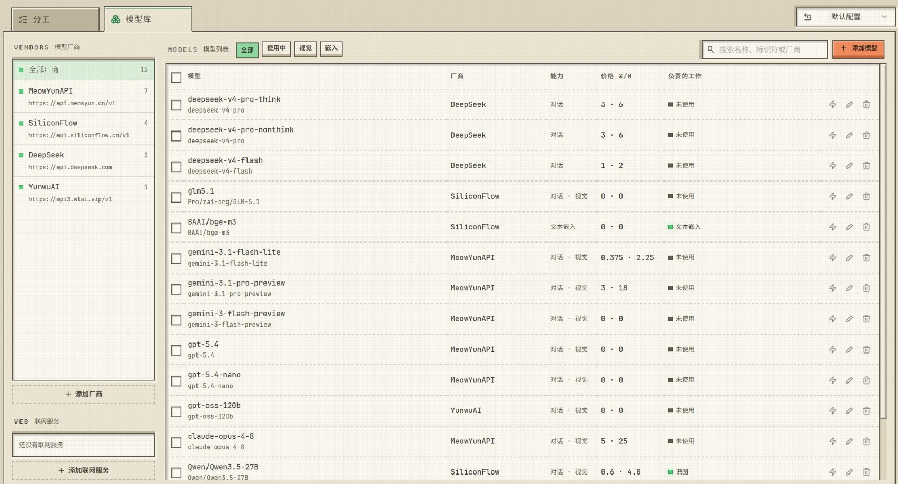
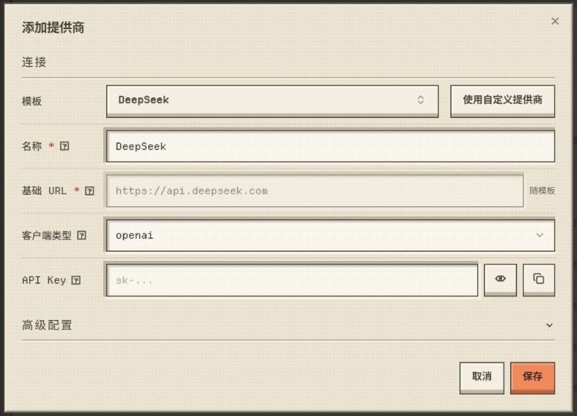
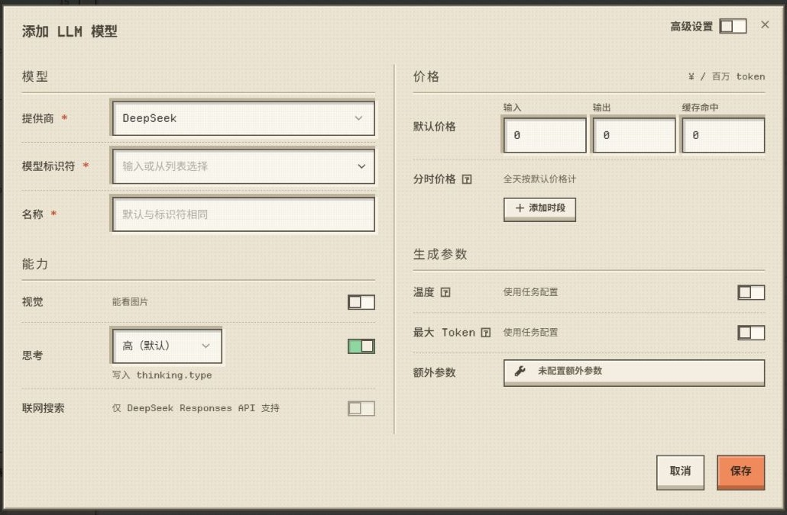
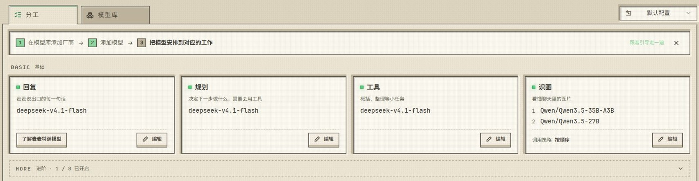
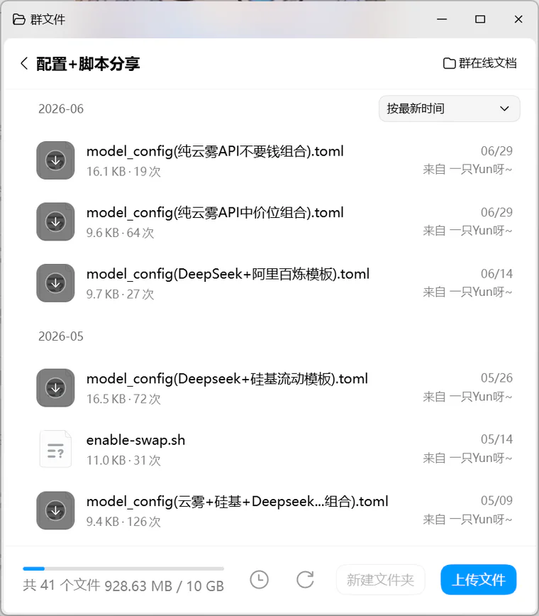

# 模型配置

通过 `模型管理` 添加模型厂商与模型，并为回复、规划、识图等任务分配模型。

模型用于处理对话、规划、图片识别等任务。配置顺序为添加厂商、添加模型、分配任务。

配置前准备服务商提供的 **API Key**，以及账号能够调用的**模型名称**。API Key 是调用服务的密钥，可以在服务商控制台创建。

## 添加模型厂商

1. 点击左侧 `模型管理`（图标下方可能简称为 `模型`）。
2. 点击页面顶部的 `模型库`。
3. 点击左下方的 `添加厂商`。
4. 在 `模板` 中选择所用服务商。模板会自动填写接口地址和客户端类型。
5. 填写便于识别的名称，将服务商提供的密钥粘贴到 `API Key`。
6. 点击 `保存`。左侧厂商列表中出现刚添加的名称，即可继续添加模型。

<figure class="conf-shot">
  
  <figcaption>模型库：左侧添加厂商，右上角添加模型</figcaption>
</figure>

<figure class="conf-shot conf-shot--compact">
  
  <figcaption>选择服务商模板后，填写名称和 API Key，再点击保存</figcaption>
</figure>

没有对应模板时，点击 `使用自定义提供商`，按照服务商文档填写基础 URL 和客户端类型。例如服务商提供的是 OpenAI 兼容接口，客户端类型选 `openai`。

## 添加模型

1. 点击 `模型库` 右上角的 `添加模型`，选择 `添加 LLM 模型`。LLM 指用于文字理解与对话的语言模型。
2. 在 `提供商` 中选择刚添加的厂商。
3. 在 `模型标识符` 中选择或输入服务商提供的模型 ID。此处使用服务商的 API 模型标识。
4. 在 `名称` 中填写便于识别的名称，例如 `日常聊天` 或 `图片识别`，该名称用于后续任务分配。
5. 如果模型支持图片输入，打开 `视觉`；文字模型保持关闭。
6. 其他参数可以先保持默认，点击 `保存`。

<figure class="conf-shot">
  
  <figcaption>模型标识符来自服务商，名称可自定义；支持图片输入的模型应开启视觉</figcaption>
</figure>

需要长期记忆时，再点击 `添加模型 → 添加嵌入模型`，添加一个服务商支持的 Embedding 模型。嵌入模型用于长期记忆的语义检索。

## 分配模型任务

切换到顶部的 `分工`，在每张卡片右下角点击 `编辑`，选择刚添加的模型并保存。

| 页面名称 | 配置中的任务名 | 功能 | 模型要求 |
| --- | --- | --- | --- |
| 回复 | `replyer` | 生成最终回复 | 选择适合日常聊天的模型 |
| 规划 | `planner` | 规划后续操作与工具调用 | 选择支持工具调用的模型 |
| 工具 | `utils` | 概括、整理等辅助工作 | 可以先与回复使用同一个模型 |
| 识图 | `vlm` | 识别图片和表情包 | 选择已开启视觉、实际支持图片输入的模型 |
| 进阶中的文本嵌入 | `embedding` | 长期记忆的向量检索 | 选择嵌入模型 |

<figure class="conf-shot">
  
  <figcaption>先完成回复、规划、工具；需要看图时设置识图，需要记忆时展开进阶设置文本嵌入</figcaption>
</figure>

开始纯文字聊天时，可以先用一个合适的文字模型承担回复、规划和工具三项工作。看图和长期记忆分别需要对应模型。

设置完成后，回到 `模型库`，点击模型右侧的闪电形测试按钮，查看测试结果。模型测试会向服务商发送请求，按服务商的计费规则计算用量。

## 常见服务商配置

| 服务商 | 厂商设置 | 模型设置 |
| --- | --- | --- |
| [DeepSeek](https://platform.deepseek.com/) | 模板选择 `DeepSeek`，粘贴在开放平台创建的 API Key | 从服务商控制台或模型文档选择当前可调用的模型 ID，添加后分配至文字任务 |
| [硅基流动](https://cloud.siliconflow.cn/i/ys2vPqSO) | 选择硅基流动模板，填写 API Key | 按需要添加文字、视觉或嵌入模型，再分别分配任务 |
| 其他 OpenAI 兼容服务 | 选择对应模板，或使用自定义提供商 | 基础 URL 和模型 ID 按该服务商提供的信息填写 |

API Key 只填写在个人管理页面中。截图分享配置时，将密钥隐藏即可。

## 配置模板参考

[云的小屋☁️（637174573）](https://qm.qq.com/q/GFJ6lOztK4)群文件的 `配置＋脚本分享` 目录中提供了模型配置示例，可以用来参考模型组合。

<figure class="conf-shot conf-shot--compact">
  
  <figcaption>可以参考模板中的模型组合，再在模型库和分工页面中填写</figcaption>
</figure>

新版将模型配置分成两份：厂商、密钥和模型列表放在 `host/model_catalog.toml`，每个机器人的任务分工放在自己的 `config/model_config.toml`。使用旧版完整模板时，可根据其中的厂商和模型信息在页面中逐项添加。

## 后续配置

完成模型测试后，继续配置 [人格与回复设置](/qqbot/maibot/config/personality)，或选择 [平台接入方式](/qqbot/maibot/adapters/adapters)。
