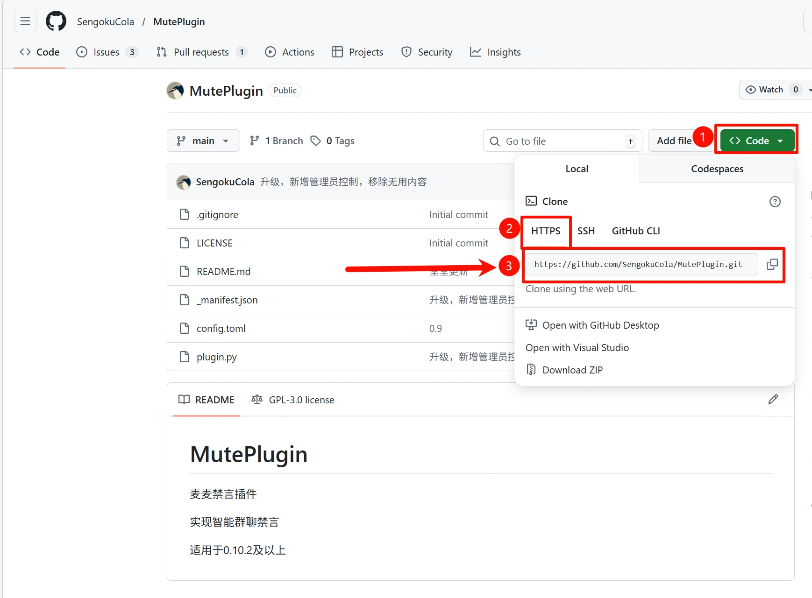

# MaiBot 插件安装与配置

本页介绍通过管理脚本、Git 和 WebUI 安装 MaiBot 插件的方法。安装第三方插件前，请先确认仓库来源、兼容版本和依赖说明。

## 插件安装目录

MaiBot 的插件目录位于 `<MaiBot 安装目录>/MaiBot/plugins/`。

## 安装插件

### 方式一：通过 WebUI 安装（推荐）

在 MaiBot WebUI 中进入`插件市场`，选择目标插件并执行安装，再回到插件管理配置插件。

### 方式二：通过MaiBot-TUI安装

1. 通过以下任一入口找到插件源码仓库：
   - 在 MaiBot WebUI 中进入`插件市场`，选择插件并点击`查看详情`，再打开`仓库：GitHub`。
   - 打开 [MaiBot 插件市场](https://plugins.maibot.chat/)，进入插件详情并打开`Source Repo`。

2. 在 GitHub 仓库中依次点击`<> Code` → `HTTPS`，复制 Git 地址，例如 `https://github.com/SengokuCola/MutePlugin.git`。

   

3. 运行MaiBot-Manager-TUI `maibot`，依次选择`插件管理` → `安装插件`，填写插件仓库地址并按照提示完成安装。

### 方式三：手动安装

1. 按照方式一中的说明打开插件源码仓库。
2. 在 GitHub 仓库中复制 HTTPS Git 地址。

   

3. 海外服务器可跳过此步骤。中国大陆服务器如无法直接连接 GitHub，可将原始 Git 地址拼接到可用的 GitHub 加速地址之后。

```bash
# 可用加速地址；更多线路参见 https://github.akams.cn/
https://gh-proxy.org/
https://hk.gh-proxy.org/
https://cdn.gh-proxy.org/
https://edgeone.gh-proxy.org/
https://gh.llkk.cc/
```

拼接示例：

```text
https://hk.gh-proxy.org/https://github.com/SengokuCola/MutePlugin.git
```

4. 进入插件目录，执行 `git clone <插件 Git 地址>`。中国大陆服务器可按上一步替换为加速地址。
5. 执行 `ls` 查看目录，再通过 `cd <插件目录>`进入刚下载的插件目录。

```console
root@RainYun-c3Srwn3w:~/test# git clone https://hk.gh-proxy.org/https://github.com/SengokuCola/MutePlugin.git
Cloning into 'MutePlugin'...
remote: Enumerating objects: 45, done.
remote: Counting objects: 100% (45/45), done.
remote: Compressing objects: 100% (29/29), done.
remote: Total 45 (delta 25), reused 31 (delta 14), pack-reused 0 (from 0)
Receiving objects: 100% (45/45), 28.99 KiB | 1.71 MiB/s, done.
Resolving deltas: 100% (25/25), done.
root@RainYun-c3Srwn3w:~/test# ls
MutePlugin
root@RainYun-c3Srwn3w:~/test# cd MutePlugin/
root@RainYun-c3Srwn3w:~/test/MutePlugin#
```
