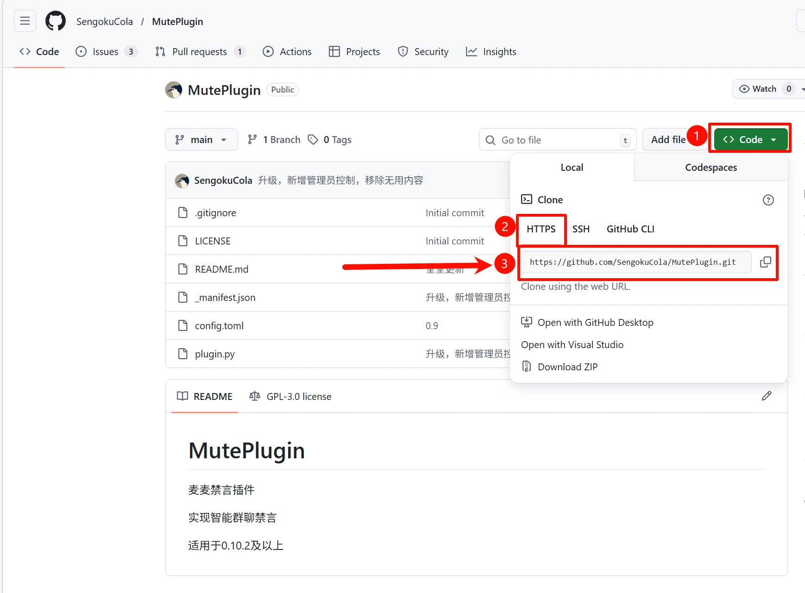

# MaiBot 插件安装与配置

插件用于扩展绘图、语音、链接解析等功能。推荐通过 WebUI 插件市场安装。

## 从插件市场安装

1. 登录 MaiBot 管理页面，在侧栏底部确认当前选中的是要安装插件的目标机器人。
2. 点击左侧 `插件市场`，搜索插件名称。可通过 [常用插件索引](/qqbot/maibot/usage/plugins_index) 了解可用功能。
3. 打开插件详情，阅读功能介绍、支持的 MaiBot 版本，以及是否需要额外准备 API Key。
4. 点击安装，等待页面提示完成。
5. 打开左侧 `插件扩展`，找到刚安装的插件，填写它需要的设置。
6. 打开启用开关并保存，按插件说明测试一次。

适配器类插件也可以在 `适配器设置 → 添加连接` 中安装。连接 QQ 的步骤见 [配置与启动](/qqbot/maibot/adapters/adapters)。

## 内置插件

新版 MaiBot 已经带有部分插件，例如 QQ 官方机器人适配器。在对应设置页开启并填写配置即可。

内置插件随 MaiBot 一起更新，可以启用或停用。QQ 官方机器人的完整设置见 [QQ 官方机器人配置](/qqbot/maibot/adapters/qq-official)。

## 插件配置入口

| 插件类型 | 页面入口 | 配置内容 |
| --- | --- | --- |
| 绘图、语音、链接解析等功能插件 | 插件扩展 | 服务商密钥、功能开关等 |
| OneBot、QQ 官方机器人等适配器 | 适配器设置 | 连接信息，以及允许聊天的群和用户 |

填写完后，点击插件页面的 `保存`。有的插件还需要单独设置服务商或模型，可以继续阅读它的详情页或 README。

如果页面显示加载失败，先展开失败信息，再查看 `日志` 中同一时间的错误。常见原因是版本不兼容、依赖没有安装好，或密钥尚未填写。

## 使用 MaiBot Manager TUI 安装

已经知道插件仓库地址时，也可以使用部署管理器：

1. 打开插件的 GitHub 页面，点击绿色的 `Code` 按钮。
2. 选择 `HTTPS`，复制仓库地址。
3. 在终端运行 `maibot`，打开 `插件中心` 中的安装入口。
4. 粘贴仓库地址，按照提示选择目标安装并完成安装。
5. 回到 MaiBot 管理页面，在 `插件扩展` 或 `适配器设置` 中填写配置并启用。



## 手动安装

手动安装时，将插件放到**当前机器人的 `plugins/` 目录**。

- 新安装的机器人通常在 `MaiBot/bots/<Bot ID>/plugins/`。
- 从旧版升级并继续使用原目录的机器人，通常在 `MaiBot/plugins/`。

进入正确的插件目录后执行：

```bash
git clone <插件仓库地址>
```

完成后回到管理页面，查看插件是否已被发现，再配置并启用。依赖按插件说明安装；管理器提供依赖修复功能时，也可以通过管理器处理。

## 更新与停用

第三方插件有新版本时，在管理页面中打开更新入口，等待完成后查看运行状态。暂时不用的插件可以先关闭启用开关。

更新前建议备份当前机器人的 `config/`、`data/` 和 `plugins/`。需要把整个 MaiBot 搬到另一台电脑时，同时保存工作区的 `host/`，操作见 [使用指南](/qqbot/maibot/usage/maintenance#备份与恢复)。

## 配置文件保存在哪里

日常设置在网页中完成，下面的路径用于备份和查找配置，均相对于当前机器人的目录：

| 路径 | 内容 |
| --- | --- |
| `plugins/<插件目录>/config.toml` | 第三方插件配置 |
| `config/builtin_plugins/<插件目录>/config.toml` | 内置插件配置 |
| `config/adapter_policy.toml` | 适配器统一的群聊、私聊接收规则 |
| `data/plugins/<插件 ID>/` | 插件保存的数据，例如 QQ 官方机器人的 ID 映射 |

更多功能可以继续查看 [常用插件索引](/qqbot/maibot/usage/plugins_index) 或 [MaiBot 插件市场](https://plugins.maibot.chat/)。
