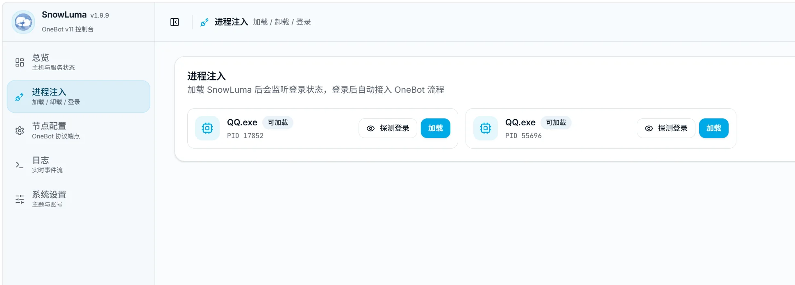

# SnowLuma 配置指南

<div class="snowluma-hero">
  <div class="snowluma-hero__copy">
    <span class="snowluma-hero__eyebrow">ONEBOT · FIRST LOGIN</span>
    <p>先登录 QQ ，再进入 SnowLuma 管理面板，依次完成~</p>
  </div>
  <div class="snowluma-signal" aria-label="SnowLuma 首次配置顺序">
    <span><b>6081</b><small>Docker 远程桌面</small></span>
    <i aria-hidden="true">→</i>
    <span><b>QQ</b><small>扫码完成登录</small></span>
    <i aria-hidden="true">→</i>
    <span><b>5099</b><small>SnowLuma WebUI</small></span>
  </div>
</div>

SnowLuma 是面向 QQ 的 OneBot v11 协议实现，可连接 AstrBot、MaiBot 等机器人框架。本页只保留首次部署最容易出错的步骤；镜像构建、多开 QQ 和高级环境变量请直接查阅官方文档。

## 先选择运行环境

| 你的环境 | 推荐方式 | 登录 QQ 的位置 |
| --- | --- | --- |
| Linux 云服务器 | [Docker 部署](#docker-部署) | 浏览器访问 `6081` 的远程桌面 |
| Windows 10 / 11 | [Windows 部署](#windows-部署) | Windows 桌面版 QQ |

::: warning 两种密码不要混淆
- **VNC 密码**：进入 Docker 远程桌面 `6081` 时使用，由 `VNC_PASSWD` 设置。
- **SnowLuma 初始密码**：进入管理面板 `5099` 时使用，只在全新数据目录首次启动时打印到 SnowLuma 日志。

它们是两套完全独立的凭据，不能互相替代。
:::

## Docker 部署

Docker 方案的正确顺序是：**启动容器 → 打开 6081 → 登录 QQ → 从日志取得临时密码 → 打开 5099**。

### 1. 创建 Compose 文件

在服务器中新建目录，并进入该目录：

```bash
mkdir -p ~/snowluma
cd ~/snowluma
nano docker-compose.yml
```

将以下内容保存为 `docker-compose.yml`：

```yaml
services:
  snowluma:
    image: ${SNOWLUMA_IMAGE:-motricseven7/snowluma:latest}
    container_name: ${SNOWLUMA_CONTAINER:-snowluma}
    restart: unless-stopped
    shm_size: 1gb
    extra_hosts:
      - "host.docker.internal:host-gateway"
    cap_add:
      - SYS_PTRACE
    security_opt:
      - seccomp=unconfined
    environment:
      VNC_PASSWD: ${VNC_PASSWD:-vncpasswd}
      SNOWLUMA_UID: ${SNOWLUMA_UID:-1000}
      SNOWLUMA_GID: ${SNOWLUMA_GID:-1000}
      SNOWLUMA_WEBUI_HOST: ${SNOWLUMA_WEBUI_HOST:-0.0.0.0}
      SNOWLUMA_WEBUI_PORT: ${SNOWLUMA_WEBUI_PORT:-5099}
      SNOWLUMA_LOG_LEVEL: ${SNOWLUMA_LOG_LEVEL:-info}
      SNOWLUMA_SCREEN: ${SNOWLUMA_SCREEN:-1920x1080x24}
      SNOWLUMA_HOOK_AUTOLOAD: ${SNOWLUMA_HOOK_AUTOLOAD:-1}
      SNOWLUMA_EXTRA_QQ_HOMES: "${SNOWLUMA_EXTRA_QQ_HOMES:-}"
      SNOWLUMA_QQ_FLAGS: "${SNOWLUMA_QQ_FLAGS:---disable-gpu --disable-software-rasterizer --disable-gpu-compositing}"
    ports:
      - "${VNC_PORT:-5900}:5900"
      - "${NOVNC_PORT:-6081}:6081"
      - "${SNOWLUMA_WEBUI_HOST_PORT:-5099}:${SNOWLUMA_WEBUI_PORT:-5099}"
      - "${ONEBOT_HTTP_PORT:-3000}:3000"
      - "${ONEBOT_WS_PORT:-3001}:3001"
    volumes:
      - ./snowluma-data:/app/snowluma-data
      - ./snowluma-qq-config:/app/.config
      - ./snowluma-qq-data:/app/.local/share
```

### 2. 设置 VNC 密码 <Badge type="tip" text="必须修改" />

推荐把密码写在与 `docker-compose.yml` **同一目录**的 `.env` 文件中：

```bash
nano .env
```

写入一行，例如：

```dotenv
VNC_PASSWD=请替换为你自己的强密码
```

`.env` 就是一个文件名以点开头的普通文本文件。启动 Compose 时，Docker 会自动读取其中的 `VNC_PASSWD`，再传给上面的 `docker-compose.yml`。

::: details 也可以直接写进 Compose
将这一行：

```yaml
VNC_PASSWD: ${VNC_PASSWD:-vncpasswd}
```

改成：

```yaml
VNC_PASSWD: "请替换为你自己的强密码"
```

这种方式更直观，但密码会直接出现在 Compose 文件里。不要把带真实密码的文件上传到 GitHub、网盘或公开聊天群。
:::

::: danger 不要保留官方示例密码
官方模板中的默认示例值可能是 `vncpasswd`。正式部署前必须替换，否则知道端口的人可能直接进入远程桌面并操作你的 QQ。
:::

### 3. 启动并检查容器

```bash
cd ~/snowluma
docker compose up -d
docker compose ps
```

`snowluma` 显示为运行状态后，查看启动日志：

```bash
docker logs -f snowluma
```

按 `Ctrl+C` 只会退出日志查看，不会停止容器。

### 4. 登录 QQ

#### 本机部署

直接打开QQ，登录Bot的QQ，并在SnowLuma控制台，注入对应进程

#### Docker 部署

确保服务器已开放`6081`端口， TCP 协议的防火墙，在自己的电脑浏览器中打开：  

```text
http://<服务器 IP>:6081/
```

`<服务器 IP>` 需要替换为实际地址。例如服务器地址是 `192.168.1.20`，就访问 `http://192.168.1.20:6081/`。

1. 页面要求输入密码时，填写前面 `.env` 或 Compose 中设置的 `VNC_PASSWD`。
2. 进入远程桌面后等待 QQ 窗口出现。
3. 使用手机 QQ 扫码，让机器人 QQ 完成登录。
4. 登录后保持 QQ 运行，不要退出账号或关闭 QQ 进程。

::: info 为什么不能先打开 5099 就结束？
`5099` 只是 SnowLuma 管理面板。QQ 没有登录时，即使 WebUI 能打开，也不会产生可工作的 QQ 节点，机器人框架自然无法收发消息。
:::

### 5. 获取 5099 初始密码

SnowLuma 使用全新数据卷首次启动时，会在日志中打印一次性管理员密码。先执行：

```bash
docker logs snowluma
```

日志较多时，可以筛选包含“临时密码”或 `initial credentials` 的行：

```bash
docker logs snowluma 2>&1 | grep -E "临时密码|initial credentials" | tail -n 1
```

::: warning 临时密码只打印一次
复用旧数据卷或普通重启不会重新生成临时密码。首次部署时请立即记录；不要把包含密码的完整日志发到群聊或 Issue。
:::

### 6. 登录 5099 并修改密码

QQ 登录完成后，再打开：

```text
http://<服务器 IP>:5099/
```

使用日志中打印的临时密码登录。进入 WebUI 后，按照提示修改为强密码。

## Windows 部署

Windows 方案不需要 VNC。正确顺序是：**安装并登录 QQ → 启动 SnowLuma → 登录 5099 → 在进程注入中加载正确的 QQ.exe**。

### 1. 准备 QQ 与 SnowLuma

1. 安装 Windows 桌面版 QQ（NTQQ），先启动 QQ，并使用手机 QQ 扫码完成登录。
2. 从 [SnowLuma Releases](https://github.com/SnowLuma/SnowLuma/releases) 下载 `win-x64` 发行包。
3. 新手建议选择不带 `lite` 的完整版，解压后运行 `launcher.bat`；精简版和 Node.js 要求请查看[官方 Windows 文档](https://snowluma.github.io/guide/deploy/windows.html)。
4. 保持 QQ 与 SnowLuma 由同一个 Windows 用户运行，并保持权限一致。不要一个使用管理员权限、另一个使用普通权限。

::: warning QQ 版本兼容
SnowLuma 的注入功能与 QQ 版本有关。QQ 自动更新后突然无法加载时，先检查 SnowLuma 官方发布说明与兼容版本，不要反复点击加载。
:::

### 2. 登录 SnowLuma WebUI

SnowLuma 首次启动时，`launcher.bat` 控制台会打印临时管理员密码。保持窗口打开，在浏览器访问：

```text
http://127.0.0.1:5099/
```

使用控制台日志中的凭据登录，然后在 `系统设置` 中立即设置强密码。临时密码只会在全新数据目录首次启动时输出一次。

### 3. 注入已经登录的 QQ

进入左侧的 `进程注入` 页面。页面会列出当前用户下可加载的 `QQ.exe`：

1. 如果只有一个 QQ 进程，确认 QQ 已完成登录后，选择该项并点击 `加载`。
2. 如果出现多个 `QQ.exe`，先点击每一项的 `探测登录`，确认它对应的 QQ 账号，再对目标账号点击 `加载`。
3. 不要因为看到多个进程就全部加载；应根据账号与 PID 选择真正作为机器人的 QQ。
4. 加载成功后，返回总览或日志页面，确认节点已识别且没有持续注入错误。

<figure class="snowluma-shot">
  
  <figcaption>存在多个 QQ.exe 时，先用「探测登录」确认账号，再加载正确的机器人 QQ</figcaption>
</figure>

::: tip 已自动加载时无需重复操作
官方版本默认支持自动发现并注入 `QQ.exe`。如果页面已经显示目标 QQ 节点为已加载或正常运行，不要再次点击加载；手动进程注入主要用于确认目标进程或自动加载没有生效的情况。
:::

## 配置 OneBot 连接

QQ 节点正常后，进入 `节点配置`，选择对应 QQ，再根据机器人框架创建并启用 OneBot 服务。

| 端口 | 常见用途 |
| --- | --- |
| `5099` | SnowLuma WebUI，不是 OneBot 连接端口 |
| `3000` | OneBot HTTP 默认端口 |
| `3001` | OneBot WebSocket 默认端口，MaiBot SnowLuma Adapter 常用 |

使用 WebSocket 时，建议设置独立的强 Token，并在 SnowLuma 与机器人框架中填写完全相同的地址、端口和 Token。

- MaiBot 可继续阅读本站的 [SnowLuma Adapter 配置](../maibot/conf#使用-snowluma)。
- 其他框架或高级网络设置请参考 [SnowLuma 官方配置文档](https://snowluma.github.io/guide/configuration.html)。

## 常见问题

| 现象 | 优先检查 |
| --- | --- |
| `6081` 无法打开 | Compose 是否映射 `6081:6081`、容器是否运行、防火墙是否只允许你的 IP |
| VNC 密码不正确 | 查看 `.env` 或 Compose 中 `VNC_PASSWD` 的实际值，修改后需重建容器 |
| `5099` 能打开但没有 QQ 节点 | 是否已经在 `6081` 或 Windows 桌面中完成 QQ 扫码登录 |
| 找不到初始密码 | 查看首次启动日志；临时密码只在全新数据目录首次启动时打印一次 |
| Windows 注入失败 | QQ 与 SnowLuma 用户/权限是否一致、QQ 版本是否兼容、是否选中了正确的 `QQ.exe` |
| 框架连接不上 `3001` | WS 服务是否启用、监听地址与端口是否正确、Token 是否一致、防火墙是否放行 |

## 官方资料

- [SnowLuma 项目仓库](https://github.com/SnowLuma/SnowLuma)
- [Docker 部署](https://snowluma.github.io/guide/deploy/docker.html)：镜像标签、完整环境变量、多账号与高级运维
- [Windows 部署](https://snowluma.github.io/guide/deploy/windows.html)：发行包、Node.js 与版本兼容说明
- [配置参考](https://snowluma.github.io/guide/configuration.html)：OneBot、运行时配置与数据目录
