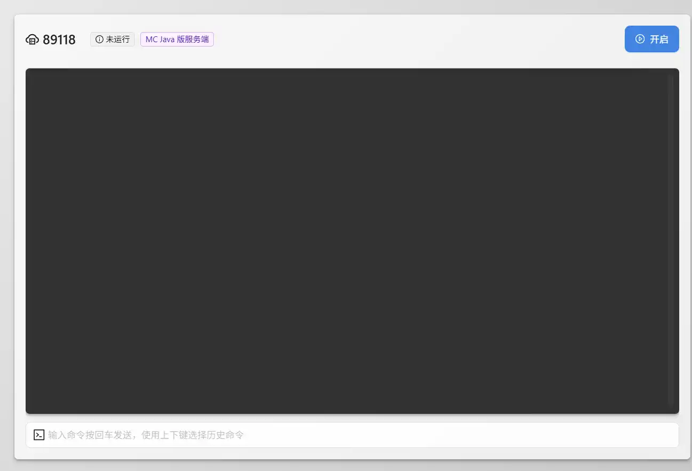

# 进阶管理

本页介绍在线模式、存档、控制台权限和白名单等常用进阶操作。修改存档或关键配置前，请先停止服务端并创建备份。

## 切换正版或离线模式

修改 `server.properties` 中的 `online-mode`：

- `true`：在线模式，需要正版账号并通过 Mojang / Microsoft 验证。
- `false`：离线模式，不执行正版验证。

具体配置项说明参见[修改服务器配置](/rainyun/mcsm/configure-mc)。


## 更换地图或重置存档

进入 `MCSM 面板` → `文件管理`。完成一次服务端启动后，通常可以看到类似以下目录结构：

::: details 文件分布
```bash{8-20}  
Minecraft-Server/
├── server.properties      # 服务器配置文件
├── eula.txt               # 用户许可协议
├── whitelist.json         # 白名单
├── ops.json               # 管理员列表
├── banned-ips.json        # 封禁IP列表
├── banned-players.json    # 封禁玩家列表
├── world/                 # 世界文件夹
    ├── data/
    ├── datapacks/         # 地图数据包文件
    ├── DIM1/              # 末地
    ├── DIM-1/             # 地狱
    ├── entities/          # 实体数据
    ├── playerdata/        # 玩家数据
    ├── poi/
    ├── region/            # 区块数据 
    ├── serverconfig/      # MOD服务器配置
    ├── level.dat/         # 存档信息+单人数据
    ├── level.dat.old/     # 存档信息备份
    └── uid.dat/
├── plugins/               # Bukkit/Spigot插件
├── mods/                  # Forge/Fabric模组
├── config/                # 模组和插件配置
├── logs/                  # 日志文件
│   ├── latest.log
│   └── ...
└── 启动脚本(可修改).sh     # 启动脚本
```
:::

### 重置存档

`world/` 目录即默认世界存档。先**关闭服务器**并备份该目录，再删除 `world/`，重新启动后等待服务端生成新存档。

### 更换为已有存档

需要替换的目标仍为 `world/`。将已有存档压缩并上传至服务器，然后用存档中的内容替换原 `world/` 内的文件。


::: warning 注意  

需要替换的是 `world` 目录内部的全部内容。可以先删除旧内容，再将**目标存档文件夹内部**的所有文件复制到 `world/`。

1. 不要把存档文件夹整体再套一层放入 `world/`。
2. 不要修改 `world` 目录名称，除非已经同步修改 `server.properties` 中的 `level-name`。

:::

## 控制台命令  

进入 `MCSM 面板` → `终端`（首次进入 MCSM 时显示的主界面）。可在终端输出区域或下方命令输入框中执行命令，控制台命令**不需要添加 `/`**。

{data-zoomable}  

## 常用命令  
前往[常用命令](../../mcs/command.md)页面查看完整列表。大部分命令既可由控制台执行，也可由具有权限的玩家执行：控制台输入无需添加 `/`，玩家则需要在聊天栏中添加 `/`。

## 给予权限/添加管理员  

进入 `MCSM 面板` → `终端`，执行 `op <玩家名称>` 将目标玩家设为 OP。

::: warning 输入要求

1. 控制台命令前不需要添加 `/`。
2. `op` 使用小写字母。
3. `op` 与玩家名称之间需要保留一个空格。
4. 尖括号 `<>` 仅用于标记变量，实际输入时不要保留。

:::  

## 开启白名单

进入 `MCSM 面板` → `终端`，执行 `whitelist on` 即可开启白名单。


::: details 白名单命令
```bash
whitelist on / off          # 打开/关闭白名单
whitelist add <玩家名称>     # 将玩家添加到白名单，请将<玩家名称>替换为实际名称
whitelist remove <玩家名称>  # 将玩家移出白名单，请将<玩家名称>替换为实际名称
whitelist list              # 查看白名单列表
whitelist reload            # 重载白名单
```
:::

::: warning
白名单要求同时启用正版验证，即在[配置文件](configure-mc.md)中设置 `online-mode=true`；否则可能导致所有玩家都无法进入服务器。
:::
