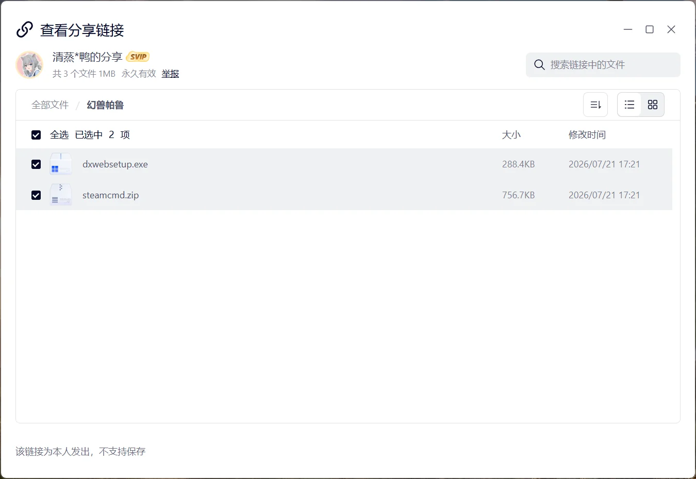

# 安装幻兽帕鲁运行环境

本页介绍 SteamCMD 与 DirectX 运行库的下载和安装。开始前请先完成[服务器选购与系统准备](intro.md)。

## 创建安装目录

打开文件资源管理器，在数据盘中新建文件夹：

```text
D:\steamcmd
```

后续示例均使用该路径。如果服务器没有 `D:` 盘，也可以使用 `C:\steamcmd`，但所有路径需要保持一致。

::: tip 路径尽量简单
建议使用纯英文、无空格的目录，不要把 SteamCMD 放在桌面、下载目录或带中文的多层文件夹中。
:::

## 下载 SteamCMD

### 方式一：从 Steam 官方下载（推荐）

1. 打开 [SteamCMD 官方说明](https://developer.valvesoftware.com/wiki/SteamCMD)。
2. 下载 [Windows 版 steamcmd.zip](https://steamcdn-a.akamaihd.net/client/installer/steamcmd.zip)。
3. 将压缩包内的全部文件解压到 `D:\steamcmd`。
4. 双击 `steamcmd.exe`。首次运行会自动下载和更新必要文件，出现 `Steam>` 提示符后即可关闭窗口。

::: warning 不要只在压缩包里运行
必须先完整解压 `steamcmd.zip`，再运行 `steamcmd.exe`。直接在压缩软件预览窗口中打开，可能导致更新文件丢失或路径异常。
:::

### 方式二：使用整理包

如果官方地址下载较慢，也可以使用整理好的文件：

- [SteamCMD 与 DirectX 夸克网盘整理包](https://pan.quark.cn/s/a03ebf2b2edf)

整理包中包含 `steamcmd.zip` 和 `dxwebsetup.exe`。SteamCMD 解压方式与官方版本相同。

{data-zoomable}

::: info 下载来源建议
能正常访问官方地址时优先使用官方文件；网盘链接可作为下载不便时的备用方式。
:::

## 安装 DirectX 运行库

Windows Server 已包含 DirectX 的核心组件，但部分游戏程序仍会调用旧版可选运行库。安装 Microsoft DirectX End-User Runtime 可以补齐这些组件。

1. 打开 [Microsoft DirectX 最终用户运行时 Web 安装程序](https://www.microsoft.com/zh-cn/download/details.aspx?id=35)。
2. 下载并运行 `dxwebsetup.exe`；也可以运行整理包中的同名文件。
3. 接受许可协议，按照安装向导完成下载与安装。
4. 安装完成后关闭窗口；若安装程序要求重启服务器，请先保存工作再重启。

::: warning 使用管理员权限
若双击后无法安装，请右键 `dxwebsetup.exe`，选择“以管理员身份运行”，并确认服务器可以访问互联网。
:::

## 环境检查

打开 `D:\steamcmd`，确认至少可以看到 `steamcmd.exe`。双击后能够正常出现 SteamCMD 窗口，即可继续[安装与启动服务端](install-server.md)。

