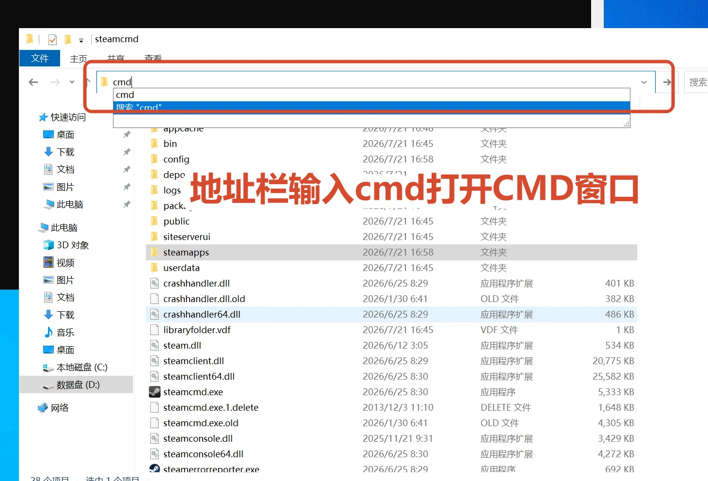
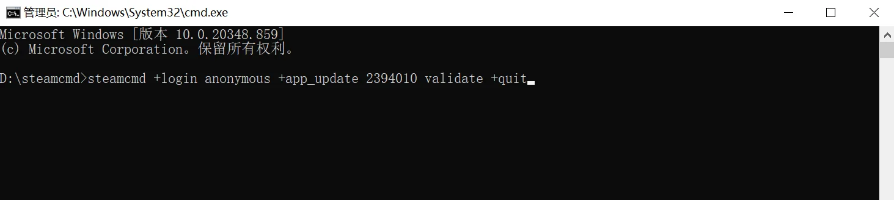

# 安装与启动幻兽帕鲁服务端

本页使用 SteamCMD 匿名登录并安装《幻兽帕鲁》专用服务器。相同命令也可以在以后更新或校验服务端文件。

::: warning 更新前先停服并备份
服务端正在运行时不要更新。请先通知玩家下线、正常关闭 `PalServer.exe`，并备份 `Pal\Saved` 目录，再执行更新命令。
:::

## 方式一：使用一条命令安装（推荐）

1. 在文件资源管理器中进入 `D:\steamcmd`。
2. 单击窗口顶部的地址栏，输入 `cmd`，然后按回车。

{data-zoomable}

3. 在打开的 CMD 窗口中输入以下命令并按回车：

```bat
steamcmd +login anonymous +app_update 2394010 validate +quit
```

{data-zoomable}

命令各部分的含义如下：

| 参数 | 作用 |
| :--- | :--- |
| `steamcmd` | 启动当前目录中的 SteamCMD |
| `+login anonymous` | 使用匿名账号登录，不需要输入个人 Steam 账号 |
| `+app_update 2394010` | 下载或更新 App ID 为 `2394010` 的幻兽帕鲁服务端 |
| `validate` | 校验文件并重新下载缺失或损坏的内容 |
| `+quit` | 安装完成后退出 SteamCMD |

下载时间取决于服务器网络。看到类似 `Success! App '2394010' fully installed.` 的提示，表示安装完成。

## 方式二：在 SteamCMD 中逐条输入

也可以双击 `D:\steamcmd\steamcmd.exe`，等待出现 `Steam>` 后依次输入：

```text
login anonymous
app_update 2394010 validate
quit
```

每输入一行都要按一次回车。第二行执行后需要等待下载和校验完成，再输入 `quit`。

## 找到服务端文件

使用默认安装位置时，服务端目录为：

```text
D:\steamcmd\steamapps\common\PalServer
```

进入该目录后应能看到 `PalServer.exe`、`Pal` 和 `Engine` 等文件或文件夹。如果没有找到，请回到 SteamCMD 窗口检查是否出现下载失败、磁盘空间不足或网络错误。

## 首次启动服务器

1. 双击 `PalServer.exe`。
2. Windows 防火墙首次询问是否允许访问时，勾选适用的网络并点击“允许访问”。
3. 保持服务器窗口开启。关闭窗口或结束 `PalServer.exe` 进程会立即停服。
4. 等待片刻后打开任务管理器，确认 `PalServer.exe` 正在运行。

::: tip 黑色窗口没有文字
服务端窗口内容较少甚至暂时空白，不一定表示启动失败。只要 `PalServer.exe` 进程仍在运行，就可以继续配置端口并尝试连接。
:::

::: warning 第一次启动很重要
首次启动会生成 `Pal\Saved` 下的配置与存档目录。至少成功启动一次后再停服修改配置或复制存档。
:::

## 更新服务端

以后游戏更新时，重复以下流程：

1. 通知玩家下线并正常关闭服务器。
2. 备份 `D:\steamcmd\steamapps\common\PalServer\Pal\Saved`。
3. 回到 `D:\steamcmd` 打开 CMD。
4. 再次执行：

```bat
steamcmd +login anonymous +app_update 2394010 validate +quit
```

5. 更新完成后重新双击 `PalServer.exe`。

完成首次启动后，继续[配置端口映射与联机](network.md)。

## 参考资料

- [Palworld Server Guide：部署专用服务器](https://docs.palworldgame.com/getting-started/deploy-dedicated-server/)

