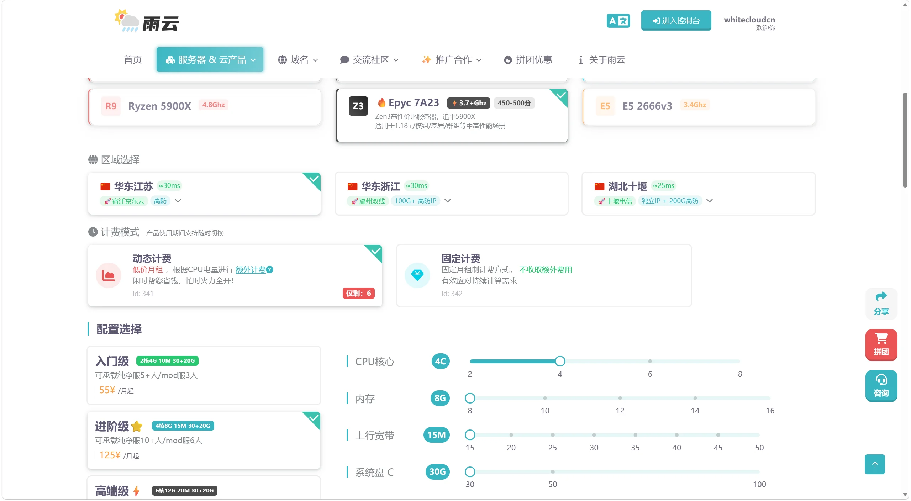
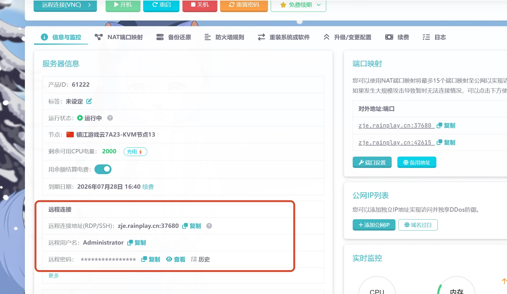

# 幻兽帕鲁服务器选购与准备

本系列文档介绍如何在雨云**游戏云 VPS** 上，使用 Windows Server 和 SteamCMD 搭建《幻兽帕鲁》专用服务器。教程面向第一次接触云服务器的新手，目前仅介绍 Windows 平台。

::: info 教程路线
1. 注册雨云账号并选择服务器配置与 Windows 系统。
2. 通过远程桌面连接 Windows 服务器。
3. [安装 SteamCMD 和 DirectX](install-env.md)。
4. [下载并启动幻兽帕鲁服务端](install-server.md)。
5. [配置端口映射并加入服务器](network.md)。
:::

## 注册雨云账号

如果还没有雨云账号，请先阅读[雨云注册与登录教程](../reg.md)，或者直接从以下入口注册：

- [雨云官网与注册入口](https://www.rainyun.com/qzyy_)

注册并登录后，点击页面右上角头像进入`账户设置`，按照页面提示完成微信绑定与实名认证。这样不仅可以正常购买和管理云产品，还可以获得原活动页面说明的首月优惠。

::: info 注册与优惠
- 使用优惠码 `qzyy` 可享受首月 5 折、续费 7～9 折，并可叠加原有优惠。
- 完成账户设置后，可以在同一个控制台中续费、重装系统、重置密码、管理端口映射和查看服务器状态。
- 优惠条件、适用产品和有效期可能调整，请以雨云官网活动说明与最终结算页面为准。
:::

::: warning 保护账号信息
请使用没有在其他网站重复使用的强密码。不要把雨云账号密码、实名认证信息或服务器远程密码发送到公开聊天中，协助排查时也应先遮挡敏感信息。
:::

## 购买游戏云 VPS

- [雨云游戏云 VPS 参考最低配](https://www.rainyun.com/rgs/qzyy_?sp=9TJkNk)
- 推荐选择离主要玩家较近的节点。距离越近，通常延迟越低。
- 计费模式、库存和价格可能变化，请以购买页面与结算页面为准。

::: warning 产品类型
本教程使用的是带完整 Windows 系统的**游戏云 VPS**，不是只能通过网页面板管理单个实例的“游戏云面板”。购买前请核对产品名称。
:::

{data-zoomable}

## 按同时在线人数选择配置

《幻兽帕鲁》服务端的负载不只取决于人数，还会受到据点数量、帕鲁数量、探索范围、世界设置和 Mod 的影响。下表适合作为新服的**起步配置**，实际运行后应结合内存占用和玩家体验调整。

| 同时在线人数 | CPU 核心 | 内存 | 上行带宽 | 建议定位 |
| :---: | :---: | :---: | :---: | :--- |
| 1～4 人 | 4 核 | 8 GB | 15 Mbps | 最低起步；适合轻量原版服 |
| 5～8 人 | 4～6 核 | 12 GB | 15～20 Mbps | 小型好友服 |
| 9～16 人 | 6 核 | 16～24 GB | 20～30 Mbps | 中型原版服或轻量 Mod 服 |
| 17～24 人 | 6～8 核 | 24～32 GB | 30～40 Mbps | 活跃玩家较多的长期服 |
| 25～32 人 | 8 核及以上 | 32 GB 及以上 | 40～50 Mbps | 满员大型服，建议留足余量 |

::: danger 8 GB 只是起步配置
官方运行要求建议使用 **4 核及以上 CPU、16 GB 内存和高速 SSD**，并指出 8 GB 虽可启动，但更容易因内存不足崩溃。选择 8 GB 或 12 GB 时，请减少同时在线人数、定期观察内存并做好存档备份；频繁爆内存时应升级配置。
:::

带宽档位属于经验起步值，不是官方硬性要求。雨云默认的 `15 Mbps` 通常可先用于 1～8 人好友服；出现全员延迟升高、回弹或上行长期跑满时，再逐档增加带宽。节点距离、线路质量和丢包率往往比单纯堆高 Mbps 更重要。

## CPU 怎么选

请选择 **4 核及以上**，可从以下型号中按预算选择：

| CPU | 适合场景 | 选择建议 |
| :--- | :--- | :--- |
| AMD EPYC 7A23 | 预算优先的小型原版服 | 性价比较高，至少分配 4 核 |
| AMD Ryzen 9 7950X | 中大型服、长期服 | 高频性能强，适合玩家和据点逐渐增多的世界 |
| AMD Ryzen 9 9950X | 高负载或 Mod 服 | 预算充足时优先选择 |
| Intel Core i9-14900K | 高负载或 Mod 服 | 高频性能强，适合追求更高性能的方案 |

::: tip 选配顺序
预算有限时，优先保证`至少 4 核`和足够内存，再考虑提高带宽。若两个方案的内存与核心数相同，通常优先选择单核性能更强的高频 CPU。
:::

## 系统与硬盘

1. **操作系统：** 选择 `Windows Server 2022` 或 `Windows Server 2019`，建议使用带桌面体验的 64 位版本，方便通过远程桌面完成操作。
2. **系统盘：** 建议至少 `30～50 GB`，为 Windows 更新和临时文件保留空间。
3. **数据盘：** 建议至少 `30 GB`，把 SteamCMD、服务端和备份放在数据盘，例如 `D:\steamcmd`。
4. **硬盘类型：** 优先选择 SSD。官方文档提示，低性能存储可能增加存档损坏风险。

## 连接 Windows 服务器

购买和安装系统完成后，需要先进入 Windows 远程桌面，之后的 SteamCMD、DirectX 和服务端操作都在远程服务器中完成。更完整的图文步骤可查看[远程管理服务器教程](../../mcs/remote.md#windows-管理)。

### 第一步：复制远程连接信息

进入雨云控制台，依次打开`云产品` → `游戏云` → 对应服务器的`管理`，在“信息与监控”页面找到：

- **远程连接地址：** 通常为`域名或 IP:端口`，NAT 产品必须保留冒号后的端口。
- **远程用户名：** Windows Server 通常为 `Administrator`，以面板显示为准。
- **远程密码：** 点击查看或复制；不要发送给其他人。

{data-zoomable}

::: tip 独立 IP 与 NAT 地址
- 独立公网 IP 且使用默认 RDP 端口时，远程桌面中通常只需填写公网 IP。
- NAT 产品应完整复制面板提供的地址，例如 `zje.rainplay.cn:37680`，不能只填写前面的域名。
:::

### 第二步：打开远程桌面连接

1. 在自己的 Windows 电脑上按 `Win + S`。
2. 搜索并打开`远程桌面连接`。
3. 在“计算机”一栏粘贴刚才复制的远程连接地址，然后点击`连接`。
4. 出现凭据窗口后，点击`更多选项` → `使用其他账户`。
5. 输入面板提供的用户名和密码，再点击确认。
6. 首次连接可能出现证书身份提示。核对连接地址无误后，选择继续连接即可进入服务器桌面。

::: warning 无法连接时
先确认服务器处于“运行中”，并再次核对地址、RDP 端口、用户名和密码。如果修改密码后忘记了新密码，可在雨云管理页面使用`重置密码`，等待操作完成后再重新连接。
:::

### 第三步：完成首次安全设置

进入桌面后建议立即完成以下操作：

1. 修改默认远程密码，并将新密码保存在可靠的密码管理器中。
2. 不要随意关闭远程桌面、防火墙或系统更新服务。
3. 退出管理时直接断开远程桌面即可；断开连接不会关闭 `PalServer.exe`。不要在 Windows 开始菜单中误点“关机”。

## 购买完成后的检查

进入 Windows 远程桌面后确认：

- Windows 为 64 位的 Server 2022 或 2019。
- `C:` 盘保留了足够的系统空间。
- 数据盘（通常为 `D:`）可以正常读写。
- 服务器可以访问 Steam 和 Microsoft 下载地址。

完成后继续[安装运行环境](install-env.md)。

## 参考资料

- [Palworld Server Guide：运行要求](https://docs.palworldgame.com/getting-started/requirements/)
