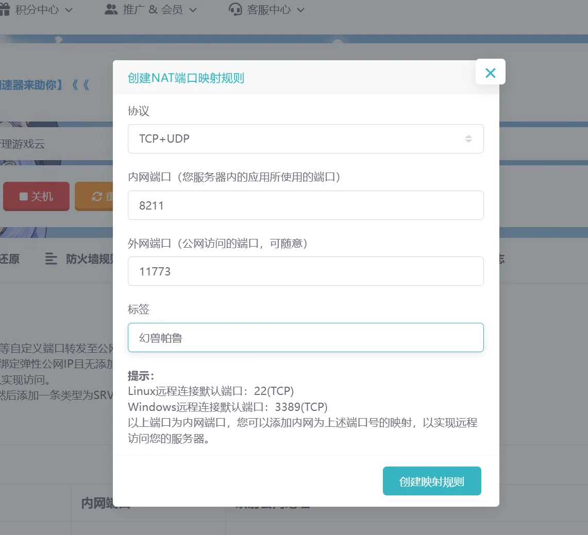

# 幻兽帕鲁端口映射与联机

《幻兽帕鲁》专用服务器默认监听 `8211/UDP`。雨云 NAT 服务器需要把内网的 `8211` 端口映射到一个公网端口，玩家才能从外网加入。

::: info 先判断网络类型
- **NAT 共享公网 IP：** 按照本页创建端口映射。
- **独立公网 IP：** 不需要创建 NAT 端口映射，通常直接使用`公网 IP:8211`连接；如果启用了 Windows 防火墙或面板防火墙，仍需允许 `8211/UDP` 入站。
:::

## 创建 NAT 端口映射

### 第一步：进入端口设置

进入雨云控制台，依次打开`云产品` → `游戏云` → 对应服务器的`管理`，在“信息与监控”页面点击`端口设置`。

{data-zoomable}

也可以直接切换到顶部的`NAT 端口映射`选项卡，然后点击`新建端口映射`。

{data-zoomable}

### 第二步：填写映射规则

按照下表填写：

| 设置项 | 填写内容 | 说明 |
| :--- | :--- | :--- |
| 协议 | `TCP+UDP` | 按截图选择最省事；游戏连接主要使用官方要求的 UDP |
| 内网端口 | `8211` | `PalServer.exe` 默认监听端口，不要填写外网端口 |
| 外网端口 | 任意可用端口 | 可直接使用系统给出的端口，例如 `11773` |
| 标签 | `幻兽帕鲁` | 仅用于区分规则，可自行修改 |

{data-zoomable}

确认无误后点击`创建映射规则`，并记下列表中显示的**映射公网地址**，例如：

```text
zje.rainplay.cn:11773
```

::: danger 不要混淆两个端口
`8211` 是服务器内部监听的端口；`11773` 只是示例外网端口。NAT 用户连接时必须填写面板实际分配的外网端口，不能照抄示例。
:::

## 检查 Windows 防火墙

如果创建映射后仍无法连接，可先允许 `PalServer.exe` 通过 Windows 防火墙：

1. 在开始菜单搜索并打开“允许应用通过 Windows 防火墙”。
2. 点击“更改设置” → “允许其他应用”。
3. 浏览并选择 `D:\steamcmd\steamapps\common\PalServer\PalServer.exe`。
4. 勾选服务器当前使用的网络类型并保存。

也可以在“高级安全 Windows Defender 防火墙”的入站规则中，新建允许 `UDP 8211` 的规则。

## 从游戏中加入服务器

1. 确认服务器上的 `PalServer.exe` 正在运行。
2. 启动《幻兽帕鲁》，进入多人游戏的专用服务器连接页面。
3. 在地址栏填写服务器地址：
   - NAT 服务器：`映射公网地址:外网端口`
   - 独立公网 IP：`公网IP:8211`
4. 点击连接并等待进入世界。

::: tip 地址填写示例
- NAT 示例：`zje.rainplay.cn:11773`
- 独立公网 IP 示例：`203.0.113.10:8211`

以上均为格式示例，请替换为雨云面板中属于你自己的地址和端口。
:::

## 无法连接时依次检查

1. `PalServer.exe` 是否仍在任务管理器中运行。
2. NAT 映射的内网端口是否为 `8211`。
3. 客户端是否填写了**外网端口**，而不是内网端口。
4. 协议是否包含 UDP。
5. Windows 防火墙或面板防火墙是否拦截了 `8211/UDP`。
6. 游戏客户端与服务端版本是否一致；不一致时先按[更新服务端](install-server.md#更新服务端)操作。

## 参考资料

- [Palworld Server Guide：运行要求与默认端口](https://docs.palworldgame.com/getting-started/requirements/)
- [Palworld Server Guide：启动参数](https://docs.palworldgame.com/settings-and-operation/arguments/)

